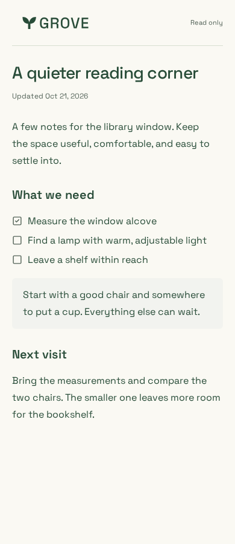
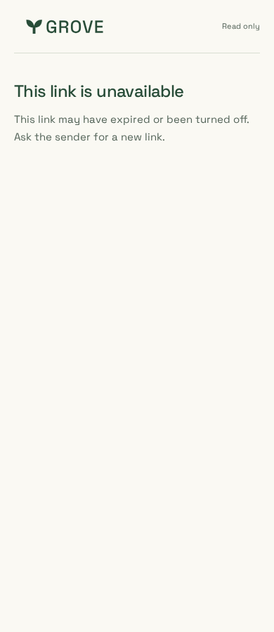
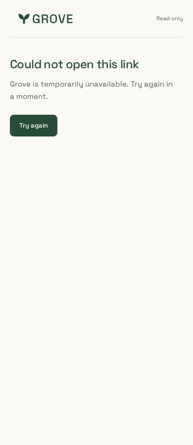
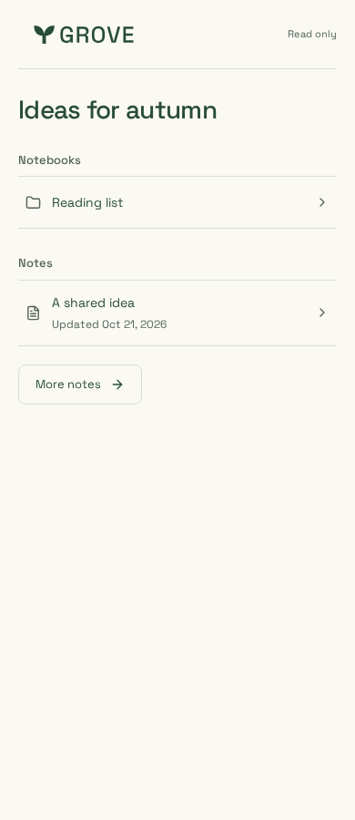
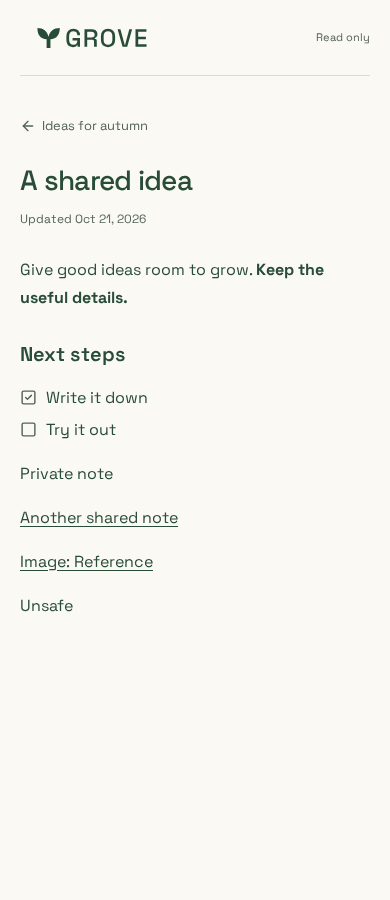
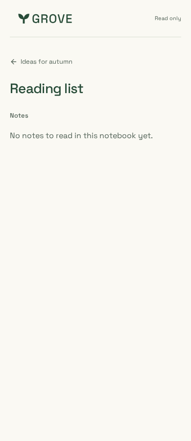

# Shared reader polish

Reviewed on 23 October 2026 using synthetic content and the production Next build
`mOR8l2vjiPKGV8V3mqXQJ` from this PR's application source (base `e13a58b`).
Node 24.21.0, pnpm 10.33.0, Playwright 1.64.1. Captures are Chromium at 900px height.

The reader keeps one Read only label, the title/date and saved content. Unavailable
links explain possible expiry and ask for a new link. Failures offer one retry.
The promotional footer, repeated sharing label and reader cookie notice are gone.

| Note | Unavailable / expired link | Temporary failure |
| --- | --- | --- |
|  |  |  |

| Notebook | Nested note | Empty notebook |
| --- | --- | --- |
|  |  |  |

Desktop: [note](note-1440.png), [notebook](notebook-1440.png),
[nested note](nested-note-1440.png), [empty notebook](empty-notebook-1440.png),
[unavailable](unavailable-1440.png), [failure](failure-1440.png).
Narrow: [unavailable at 320px](unavailable-320.png), [failure at 320px](failure-320.png).

## Verification

- Root lint, types, build and all five packaged artifacts pass; website lint,
  types, telemetry-fixture production build and bundle budgets pass.
- All **40 Chromium** sharing, telemetry, consent/tag-manager and public-site
  scenarios pass. All **five iPhone/WebKit** shared-reader scenarios pass in the
  Playwright Noble container (native host libraries are unavailable).
- Manual browser automation checks all six states at 1440/390/320px: no horizontal
  overflow or WCAG 2A/AA/2.1AA violations. Keyboard skip/focus, enlarged recovery
  text, retry after recovery and consent choices after navigating home pass.
- HTML/Open Graph/Twitter titles and descriptions stay generic on every state;
  no note text, token URLs, canonical URL, author/keyword tags or marketing image.
  Referrer meta and no-store/no-referrer/noindex HTTP headers are present.
- Active notes and notebook navigation work without JavaScript. The installed
  Next version's nested 404/error fallback relies on client rendering; no-JavaScript
  unavailable-state UI is not qualified. A 404 still returns the correct status,
  generic metadata and privacy headers. This change retains that routing behavior.

Existing [sharing](../../../sharing.md) scope, revocation and expiry contracts apply.
