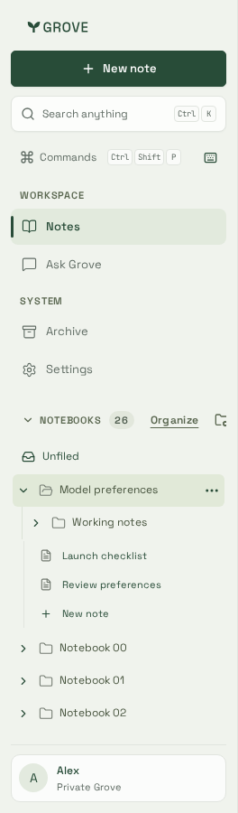
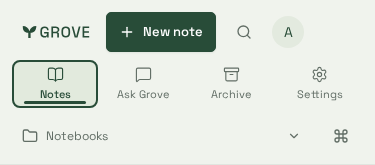
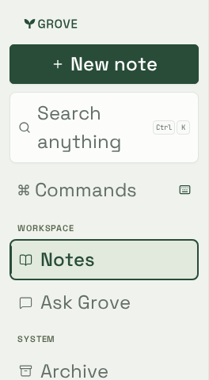

# Seamless sidebar

Fixture captures from the automated sidebar suite (synthetic notebooks, no
account data). Production CSS, Chromium.

| Notebooks with active section                                                     | Phone navigation                                         | Enlarged text                                            |
| --------------------------------------------------------------------------------- | -------------------------------------------------------- | -------------------------------------------------------- |
|  |  |  |

- **Workspace** (Notes, Ask Grove), **Notebooks** (Unfiled plus collapsible
  tree with a notebook count), then **System** (Archive, Settings last).
- The active destination and notebook carry a forest edge bar plus the pill;
  phones show all four destinations in one row with an underline marker.
- The notebooks heading collapses on desktop and remembers the choice in this
  browser only. The account card is a quiet surface, not a menu.
- Enlarged text keeps every destination reachable without horizontal scrolling.
