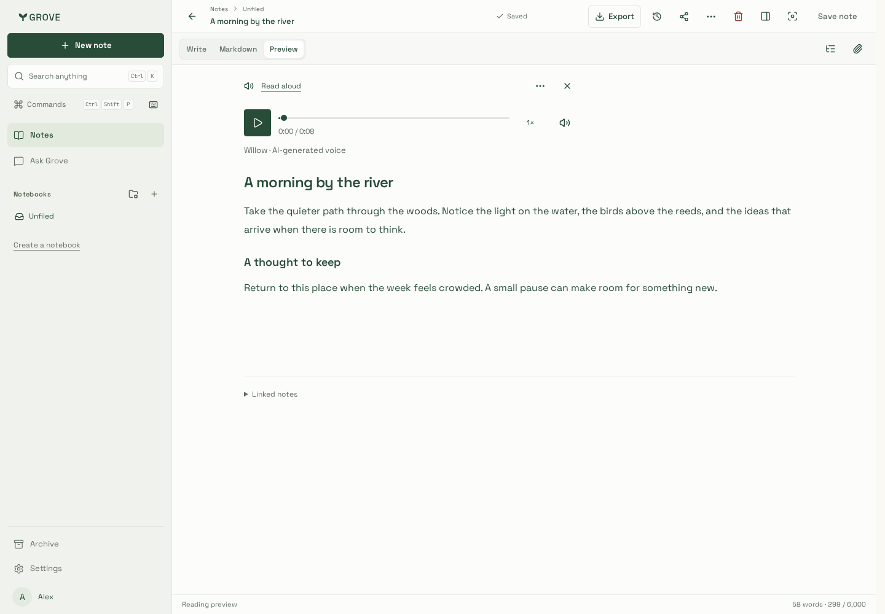
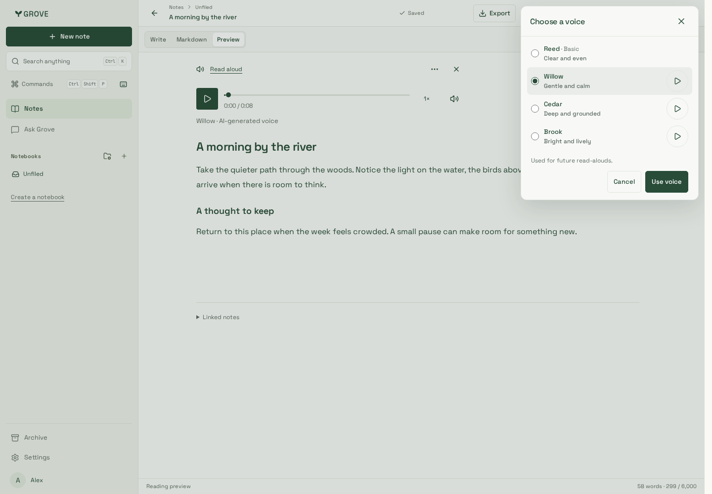
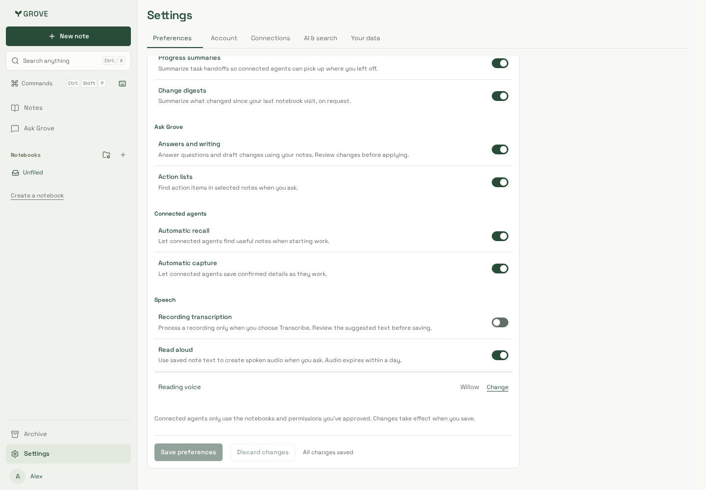
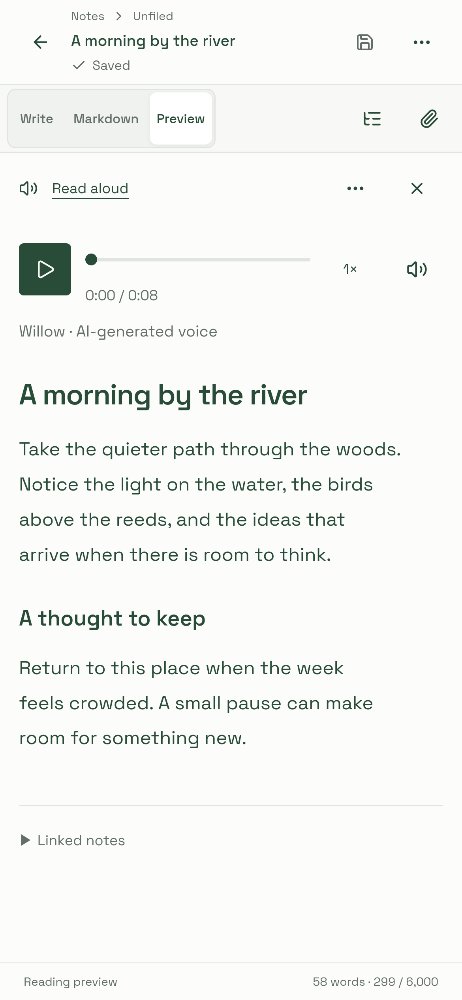
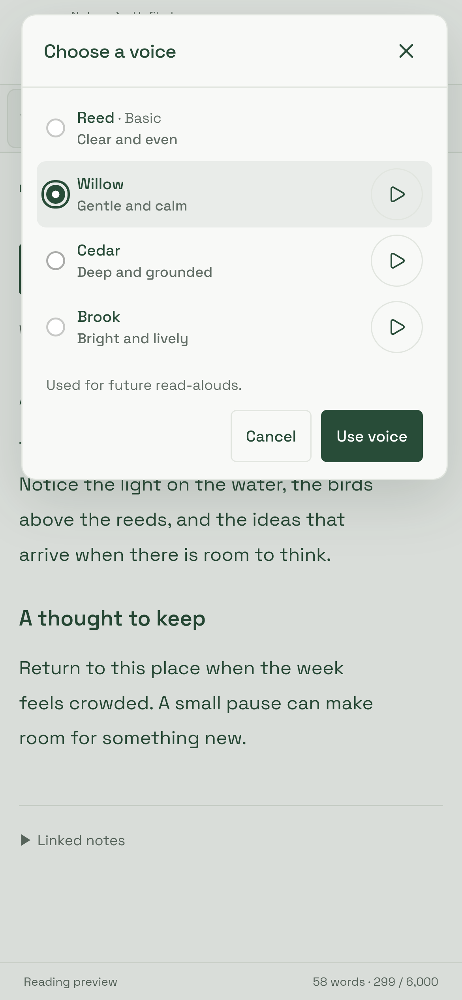
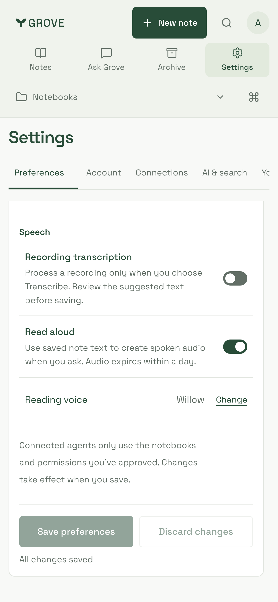
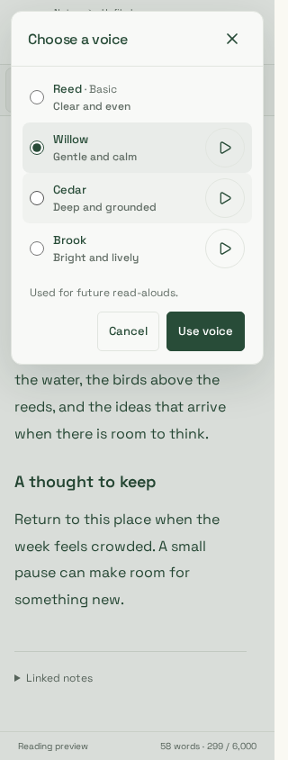
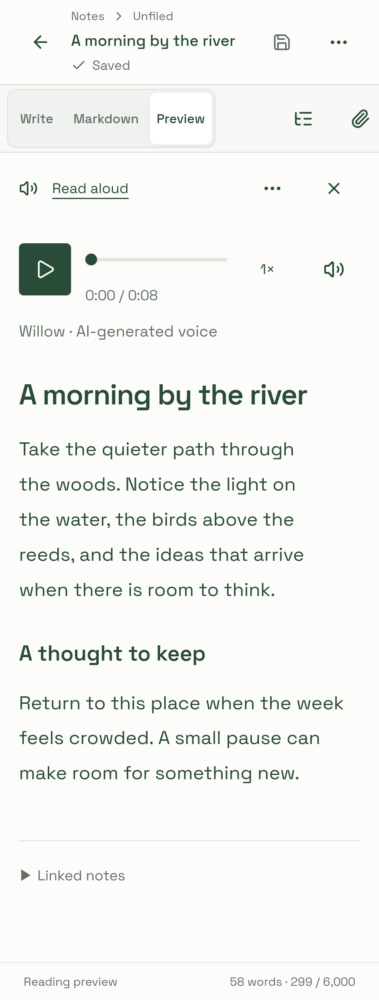

# On-demand voice selection

Captured and visually reviewed on 24 October 2026 from source `1506a85`, using
production CSS build `rIyJK3KJf2fQ6BtlkOapi`. The actual dashboard components run
against synthetic API responses, an invented river note and bundled sample MP3s.
The narration endpoint returns the fixed Willow sample to verify playback behavior;
these captures do not represent newly synthesized narration of the displayed note.

Chromium uses desktop emulation. WebKit uses Playwright's iPhone 13 touch/device
profile at 3× pixel scale, resized to the labelled CSS viewport widths. Its 1440px
checks verify layout, not desktop Safari. WebKit runs in the supported
`mcr.microsoft.com/playwright:v1.64.1-noble` container because the host lacks its
system libraries.

## Reviewed captures

Ordinary listening keeps only playback controls and the applied voice. **Read aloud
options** → **Change voice** opens compact rows with a selected highlight and circular
preview controls. Settings shows a compact summary.
Compare the [original inline picker](../speech-voices/README.md).

| Desktop playback · 1440px                                    | On-demand chooser · 1440px                          | Settings summary · 1440px                                        |
| ------------------------------------------------------------ | --------------------------------------------------- | ---------------------------------------------------------------- |
|  |  |  |

| iPhone playback · 390px                               | iPhone chooser · 390px                                                  | iPhone Settings · 390px                                  |
| ----------------------------------------------------- | ----------------------------------------------------------------------- | -------------------------------------------------------- |
|  |  |  |

| Narrow chooser · Chromium 320px                                          | Narrow playback · iPhone/WebKit 320px                         |
| ------------------------------------------------------------------------ | ------------------------------------------------------------- |
|  |  |

## Verification

An external actual-component driver passed **15 journey groups in each engine**:

- Chooser hidden during ordinary playback; opening, browsing and cancelling make
  zero preference, synthesis or sample requests.
- Independent samples retain the radio candidate and saved preference. Playback is
  exclusive, errors retry in place, and dismissal releases sample sources.
- Only confirmation saves; quick saves serialize with at most one active request.
- Opening, cancelling and same-voice confirmation preserve the narration element
  and position. Samples pause it; a confirmed different voice releases it.
- Account refreshes preserve prepared identity and edited chooser candidates.
- Browsing leaves pending preparation alive. Confirmation fences/cancels late
  replies; both close controls and navigation handle lost enqueue responses.
- Settings confirmation edits only the draft. Held/failed saves retain newer
  candidates and drafts; Discard restores the saved choice.
- Read aloud off hides the Settings summary without losing its voice. Unavailable
  choices stay remembered; off/all-unavailable players hide configuration.
- Failed quick saves retain the applied voice with visible retry. Failed
  cancellation remains uncertain until the server confirms it.
- Native radio arrows, menu/dialog focus return, Escape/backdrop dismissal,
  1440/390/320px bounds, a 320×420 short viewport and WCAG A/AA checks pass.

Visual review also caught and corrected a form-style specificity collision that
stacked radio inputs above their labels. Final checks assert horizontal radio rows
and the screenshots above show the corrected layout.

Root/site lint, types and production builds pass, along with **nine artifact
checks**, **19 speech provider/narration tests**, **31 existing Chromium models/cache
cases** and **four existing iPhone/WebKit Settings cases**. The local bundle gate
passes at **432,958 gzip bytes** for Notes, with the editor deferred; Settings is
**425,623 gzip bytes**. Telemetry is disabled in this local build, so these figures
are not directly comparable to the original telemetry-enabled voice release.

The [speech guide](../../../speech.md) and [verification guide](../../../development/testing.md)
describe the workflow and repeatable matrix. Original provider qualification and
sample provenance remain in the [selectable-voices gallery](../speech-voices/README.md).
