# Selectable read-aloud voices

Captured and visually reviewed on 24 October 2026. The actual Grove components run
against synthetic API fixtures; screenshots contain an invented river note and
fixture account. Production CSS comes from build `bIHR8uR0FWEGyU8Fx8nT-`, based on
development `f8e6b0f` plus the voice-selection changes committed with this gallery.
No personal note or provider credential appears in the captures.

Chromium uses desktop emulation. WebKit uses Playwright's iPhone 13 touch/device
profile, including its 3× pixel scale, resized to the labelled CSS viewport widths;
the 1440px WebKit captures are layout checks, not desktop Safari qualification.

## Reviewed captures

| Chromium · 1440px                                      | Chromium · 390px                                 | Chromium · 320px                                  |
| ------------------------------------------------------ | ------------------------------------------------ | ------------------------------------------------- |
| 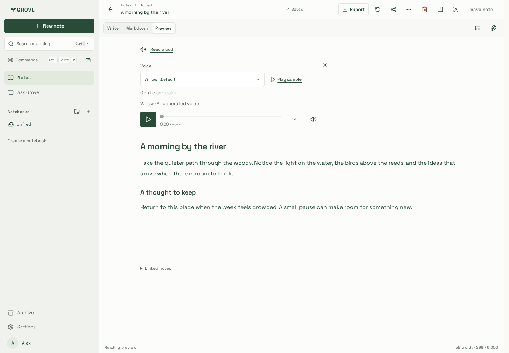 | 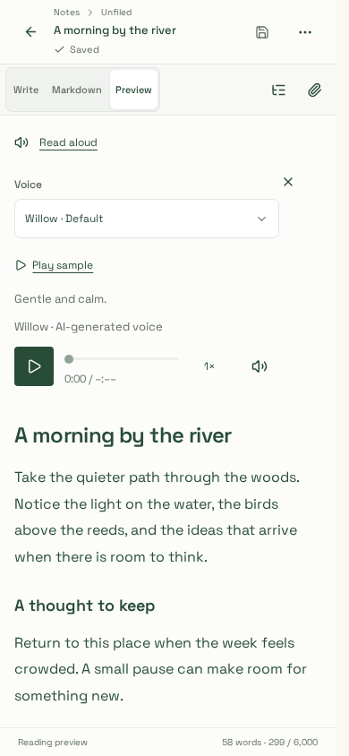 | 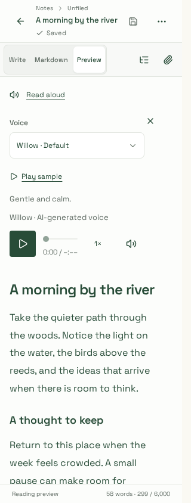 |

| Chromium · menu 1440px                                    | Chromium · settings 1440px                              | Chromium · settings 320px                             |
| --------------------------------------------------------- | ------------------------------------------------------- | ----------------------------------------------------- |
| 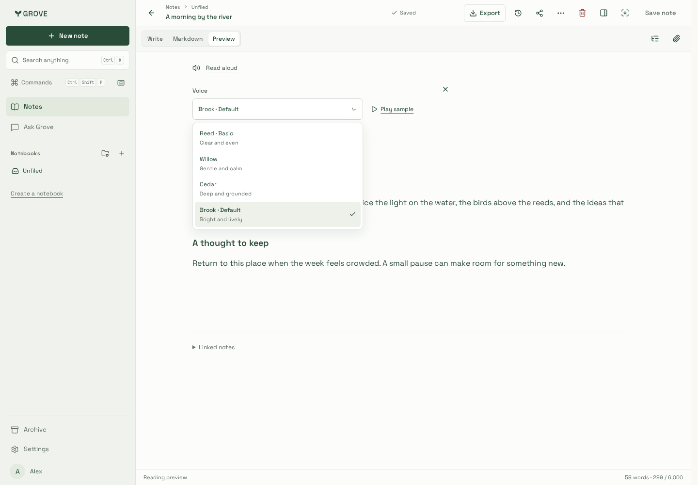 | 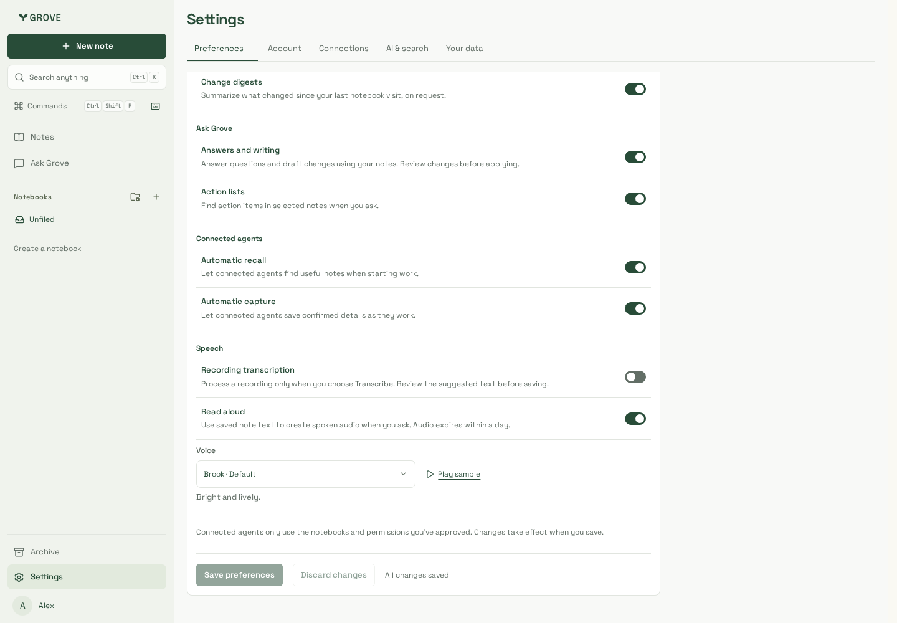 | 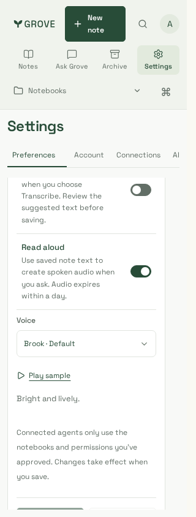 |

| iPhone/WebKit · 1440px layout                               | iPhone/WebKit · 390px                                | iPhone/WebKit · 320px                                 |
| ----------------------------------------------------------- | ---------------------------------------------------- | ----------------------------------------------------- |
| 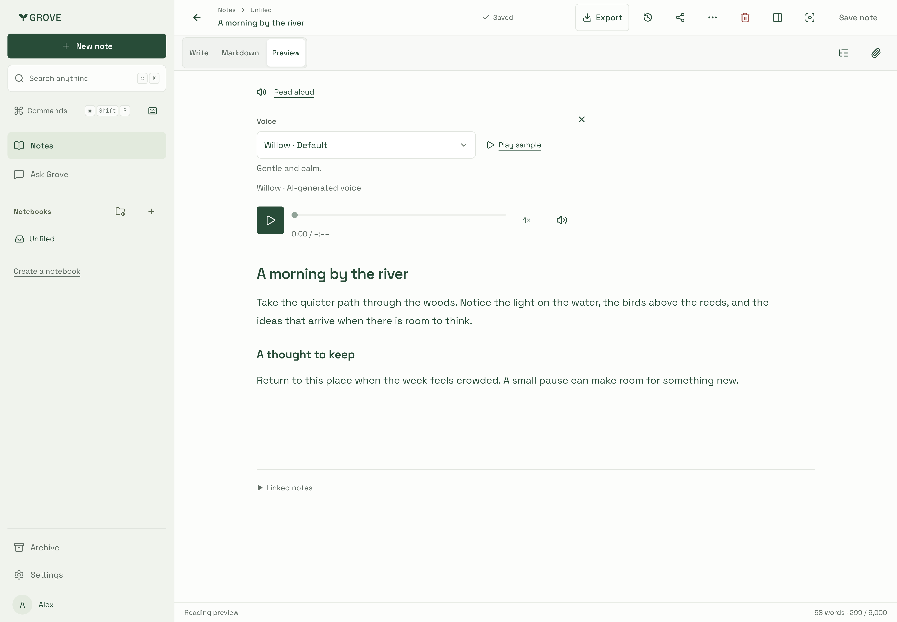 | 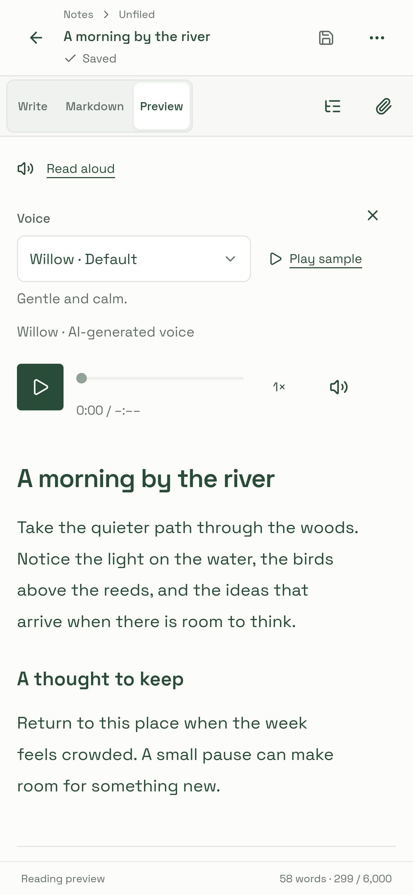 | 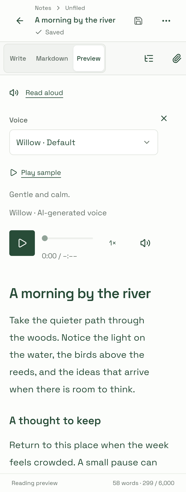 |

| iPhone/WebKit · menu 1440px                            | iPhone/WebKit · settings 1440px                           | iPhone/WebKit · settings 320px                      |
| ------------------------------------------------------ | --------------------------------------------------------- | --------------------------------------------------- |
| 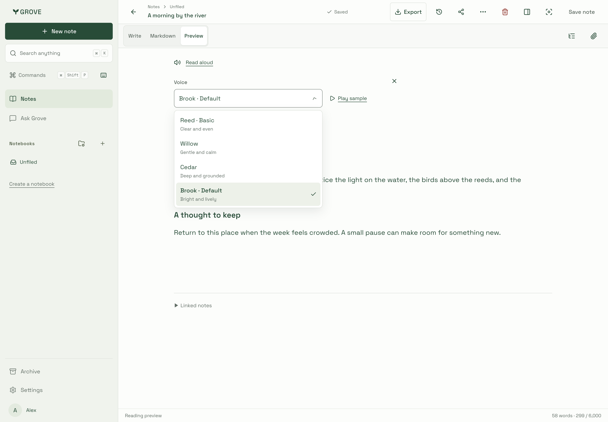 | 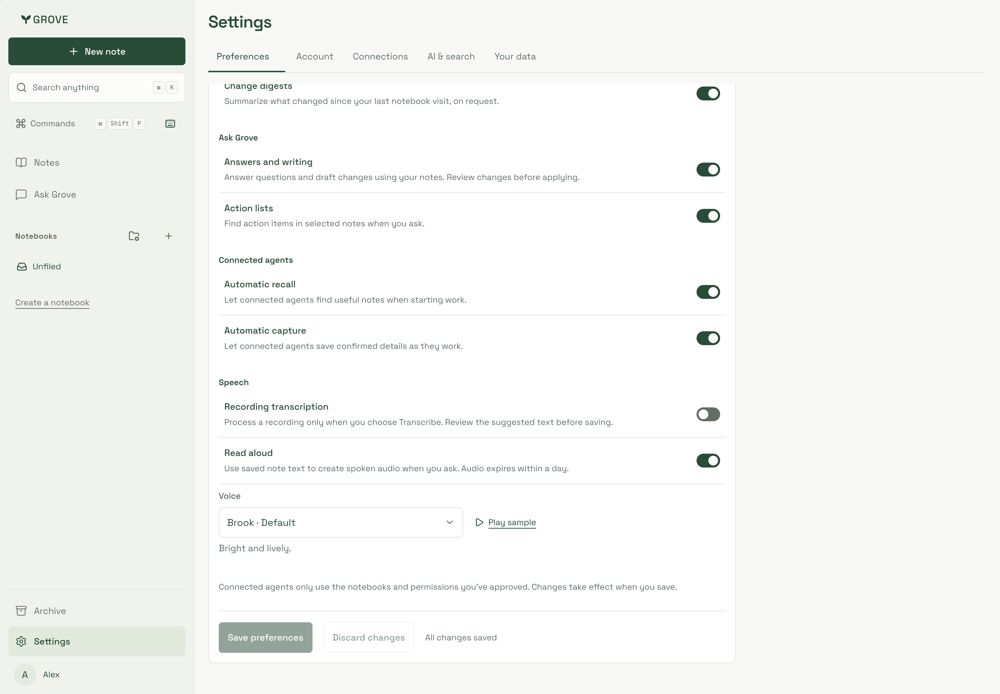 | 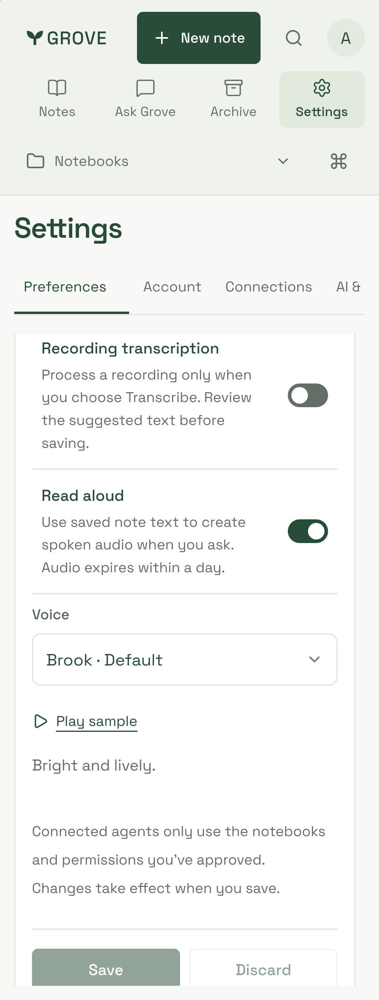 |

The settings captures show the scrolled Speech section; the form remains scrollable
to its Save/Discard controls on short screens. Read-aloud audio is ready but unloaded
until Play, so its initial duration is intentionally unknown.

## Browser evidence

Eleven actual-component journey groups pass in each engine:

- Opening controls causes no synthesis, preference write or sample download.
- Rapid voice changes serialize saves, retain the latest choice and return focus.
- Samples load only on Play; changing voice releases their old source.
- Preparation fixes the selected voice even after a default refresh. Sample and
  narration playback pause each other; switching voices releases narration.
- Late enqueue replies after switching are cancelled and never relabelled.
- Both close controls and in-app navigation cancel accepted-but-lost requests.
- A held Settings save preserves a newer draft; Discard restores the saved choice.
- Failed quick saves keep the explicit local voice and offer a save retry.
- An unavailable remembered voice remains selected without automatic fallback.
- Keyboard selection/focus, 1440/390/320px overflow and WCAG A/AA checks pass.
- Cancellation failure is reported as uncertain until confirmed by the server.

Node 24.21.0, pnpm 10.33.0 and Playwright 1.64.1 were used. WebKit runs in
`mcr.microsoft.com/playwright:v1.64.1-noble`. The fixture uses actual MP3 bytes but
synthetic task responses; backend/database regressions independently verify routing,
cache identity, worker races and authorization. These browser journeys make no paid
provider calls. The existing suite passed 221 Chromium cases initially; two trace
directory collisions passed on isolated rerun. Four existing iPhone/WebKit settings
cases also pass. Concurrent suites require separate ports and output directories.

## Provider qualification and sample provenance

The [sample manifest](../../../../packages/website/public/voice-samples/README.md)
records exact synthetic text, preset/model/audio settings, timings and SHA-256
checksums. Reed has no sample because OpenAI credential access was unavailable.
All three MiniMax preset IDs were confirmed by an authenticated system-list read.

Additional live Willow synthesis used only synthetic text:

| Case                                       | UTF-16 units | MP3 bytes | Generation | Audio duration |
| ------------------------------------------ | -----------: | --------: | ---------: | -------------: |
| Numbers and dates                          |          127 |   109,716 |    2.283 s |       13.479 s |
| French, Spanish, German and Japanese prose |          112 |    86,100 |    1.830 s |       10.530 s |
| Literal control-like notation              |           99 |    80,052 |    2.052 s |        9.764 s |
| Maximum-length narration                   |        3,000 | 1,662,036 |    7.348 s |      207.576 s |

All four responses decoded successfully as mono 32 kHz MP3. The maximum case is
within Grove's 3 MiB/45-second provider limits; this small observation is not a
latency guarantee. Subjective listening, long-note fatigue and language-quality
acceptance remain unverified. Voice descriptions reflect the curated preset names.

[Speech behavior/privacy](../../../speech.md),
[022 rollout](../../../deploy.md#selectable-speech-voices-022) and
[verification guide](../../../development/testing.md) describe the installation
gate, provider-specific retention and remaining operational checks.
