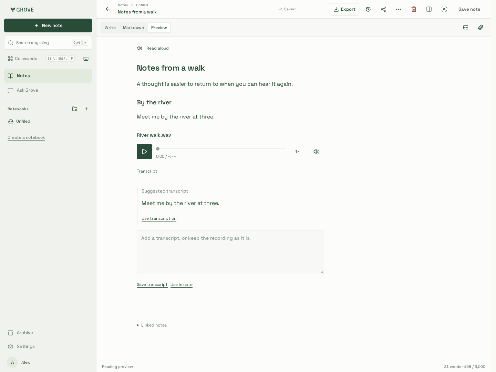
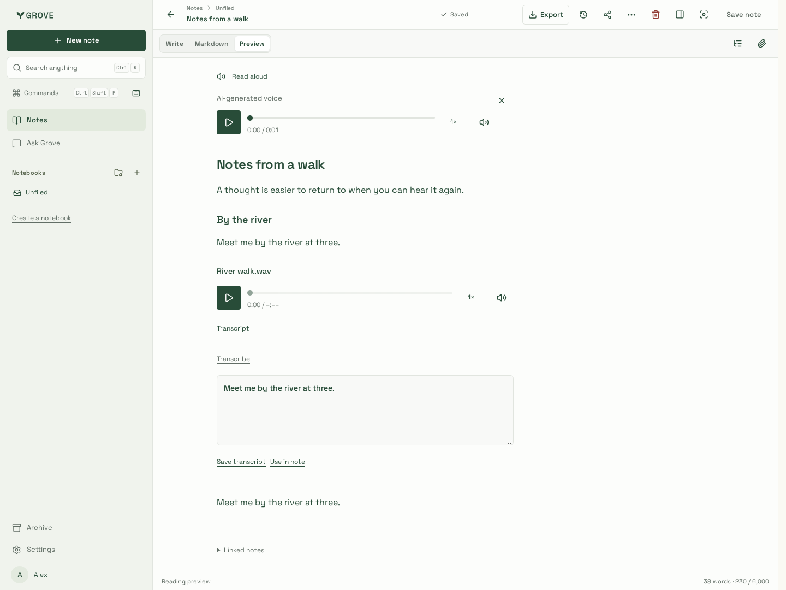
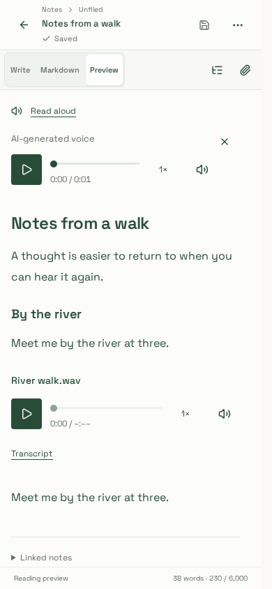
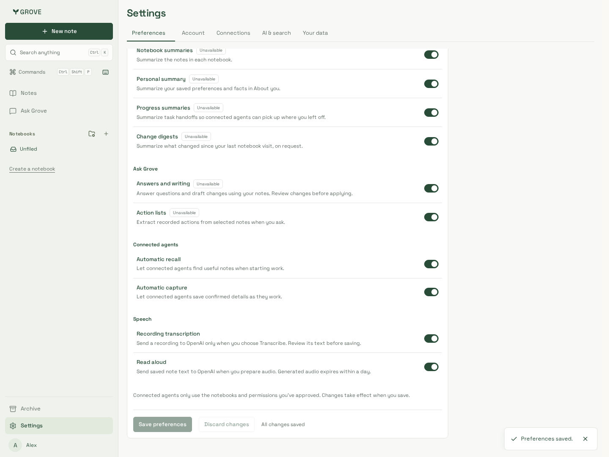
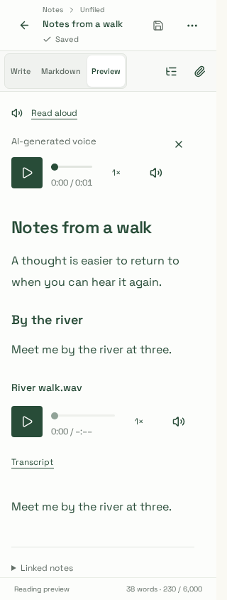
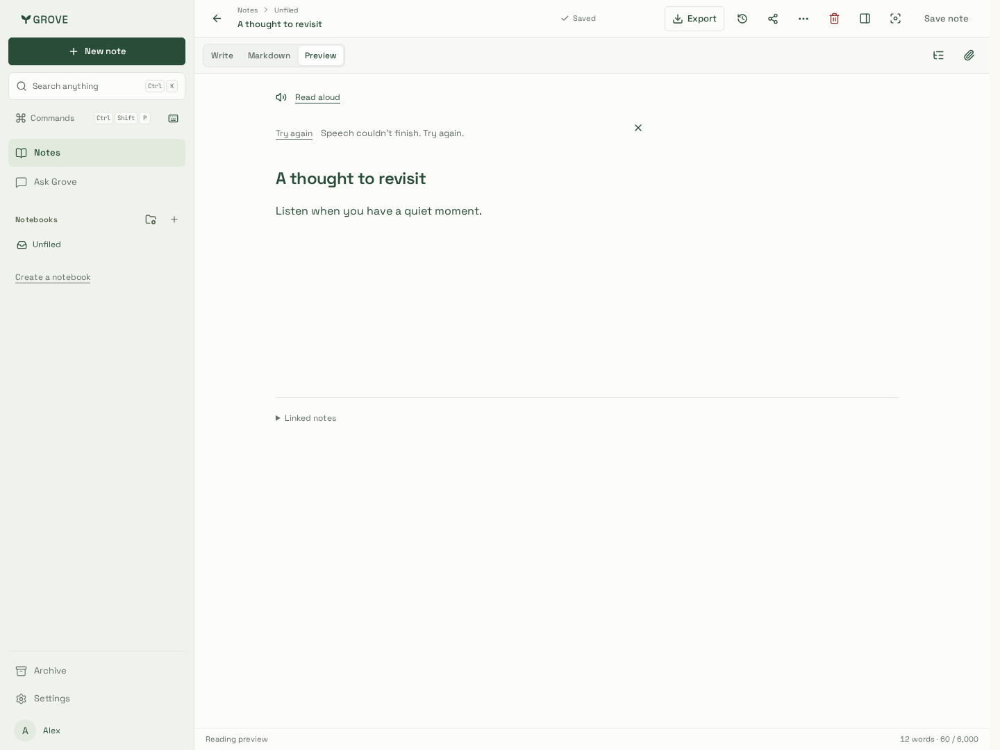

# Speech verification

Synthetic notes and a disposable real API/PostgreSQL/private storage fixture;
deterministic provider responses and locally synthesized audio exercise the actual
bulk worker handlers and real MP3 playback. No personal recordings or account
content are used. These captures use integrated application source `a404ad8`
(#95 parent `93983e5`) and production CSS build `TlBPUVpYjbteqpreIY5-S`.

| Transcription review                                        | Read aloud                                                | Phone                                   |
| ----------------------------------------------------------- | --------------------------------------------------------- | --------------------------------------- |
|  |  |  |

| Independent preferences                    | Narrow phone                          | Provider failure                    |
| ------------------------------------------ | ------------------------------------- | ----------------------------------- |
|  |  |  |

[Cancellation state](cancelled.png). Chromium and touch/mobile WebKit journeys
verify opt-in/no automatic inference, queued STT, explicit candidate replacement,
transcript save/use, generated playback, exact-source cache reuse without another
provider call, failure/retry, cancellation propagation through either close control,
ready-player close/reopen, retained heading jumps/pinning, 1440/390/320px bounds
and WCAG A/AA checks. The preview remains a document-only surface for editor
shortcuts; speech tools are siblings rather than authored Markdown content.

Both engines also verify production Next public-reader isolation: no speech or
private transcript controls, no provider/authentication/telemetry calls, original
WAV playback with application JavaScript enabled or disabled, and anonymous
derived-audio API denial. No-JavaScript WebKit checks native-control rendering and
starts the browser codec through automation; native OS-control interaction is not
qualified. All disposable share links are revoked after each journey.

Integrated local gates pass: 229 backend cases (four optional-service skips), all
223 Chromium scenarios, 12 focused iPhone/WebKit navigation cases, root/site
lint/types/builds, five packaged artifacts, release/deployment contracts, workflow
lint and bundle budget. Notes entry is 487,996 gzip bytes; the editor stays deferred.

A separate bounded real OpenAI check synthesized **“Meet me by the river at three.”**
with tts-1/alloy (30,336 MP3 bytes), converted only that synthetic output to PCM WAV,
then transcribed it with whisper-1 (60,750 WAV bytes). The expected phrase was
recognized. This is API/codec integration evidence, not a general speech-quality
benchmark or a physical-device/microphone qualification. Credentials stayed in
ignored private custody; audio fixtures remain outside tracked source.
