# Streamlined workspace

Reviewed mobile (390/320px) and desktop (1440px) pages with synthetic notes and
production CSS. Refreshed after integrating development `4cc9309` and fixing the
mobile document's unused bottom grid row. Build ID: `GMAnZYbdqv--SjtYjQtjp`.
All 18 views pass automated WCAG A/AA and horizontal-overflow checks. Focused
WebKit verification also covers filters, navigation, menus, full-height notes,
short windows and focus return. Physical keyboards/browser chrome remain unqualified.

| Desktop · 1440px                | Phone · 390px                  | Small phone · 320px            |
| ------------------------------- | ------------------------------ | ------------------------------ |
| 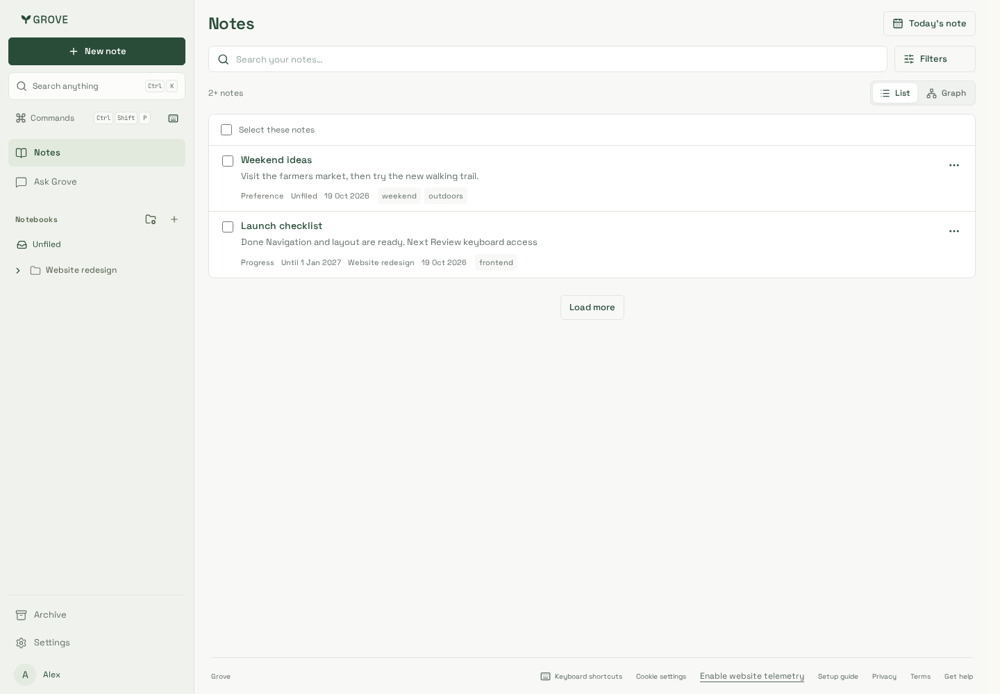        | 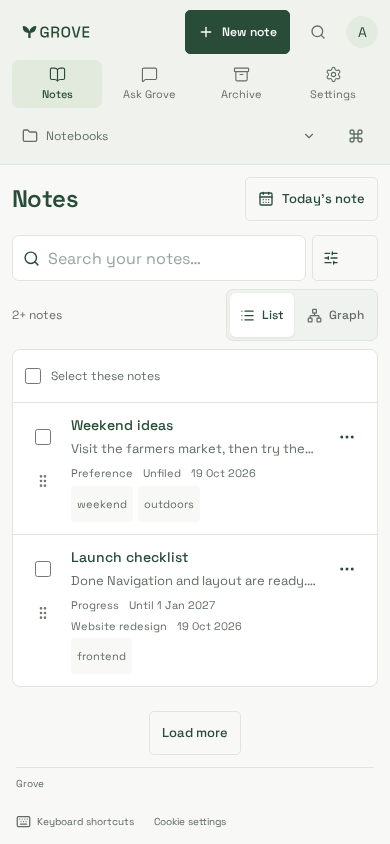        | 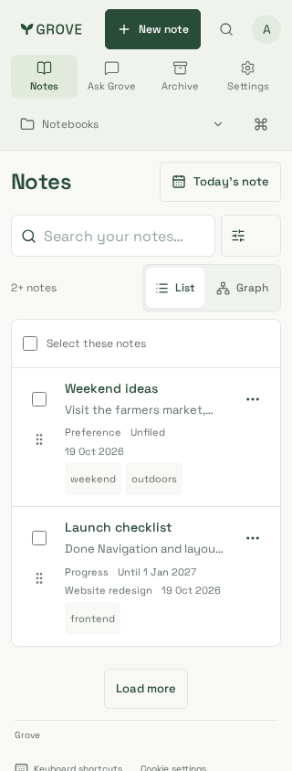        |
| 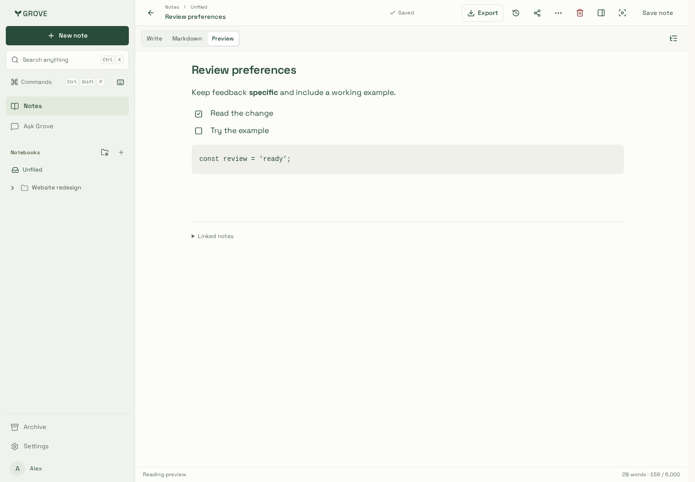 | 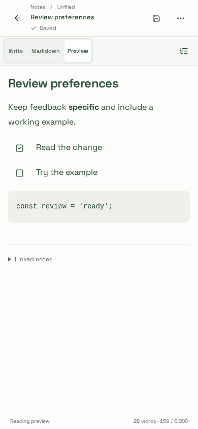 | 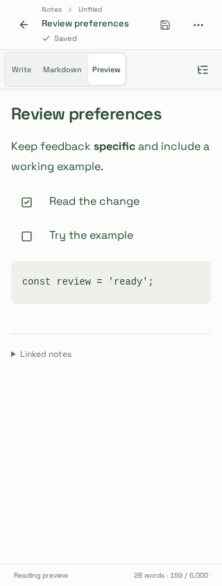 |
| 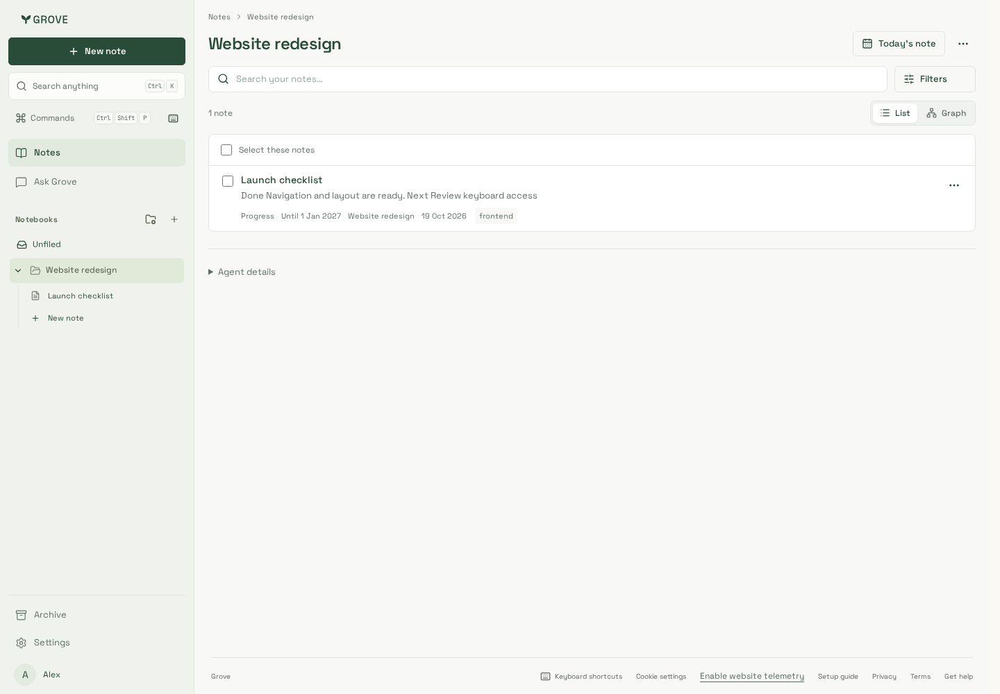  | 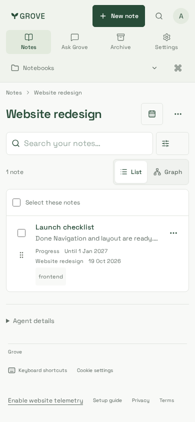  | 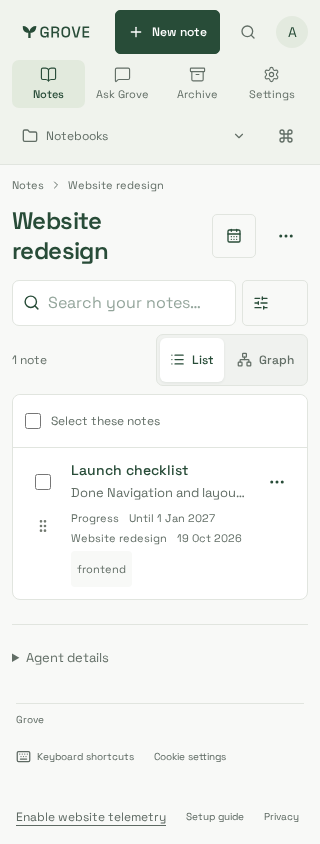  |
| 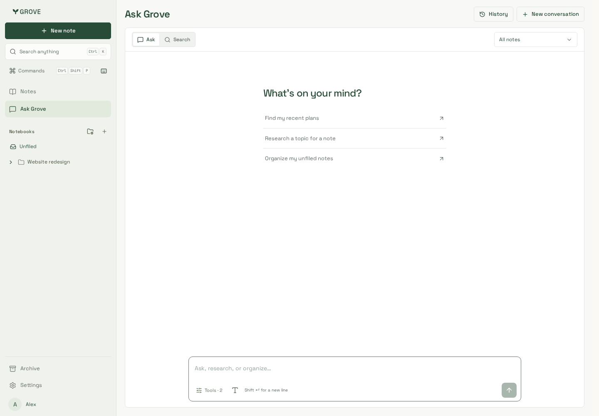      | 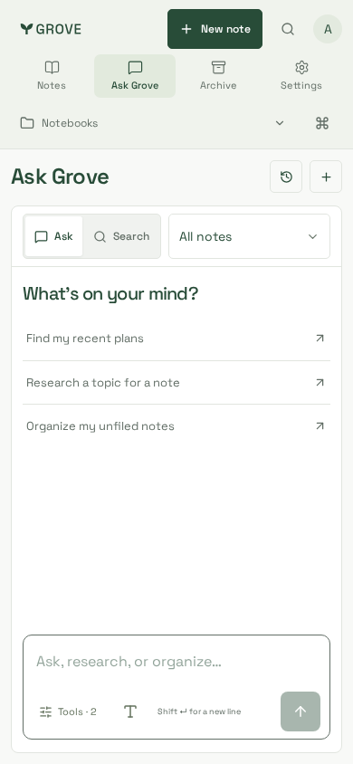      | 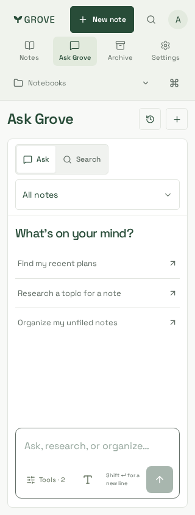      |
| 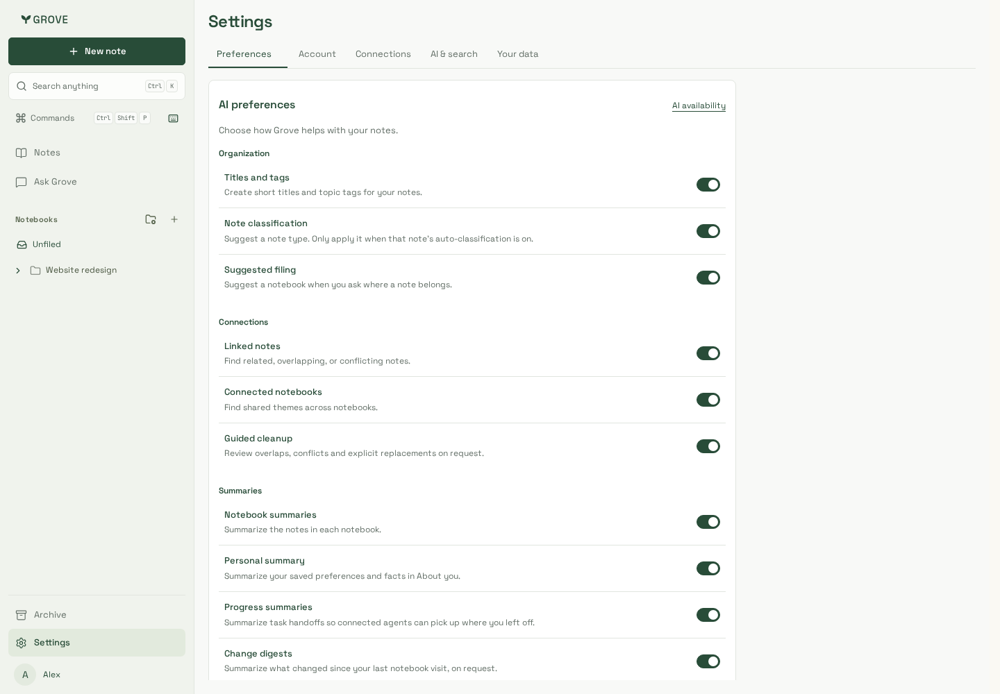  | 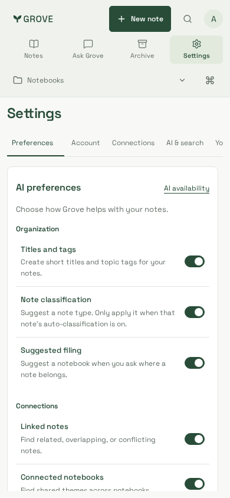  | 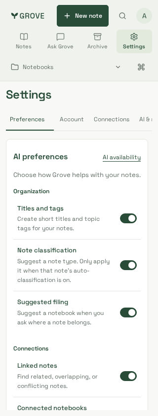  |
| 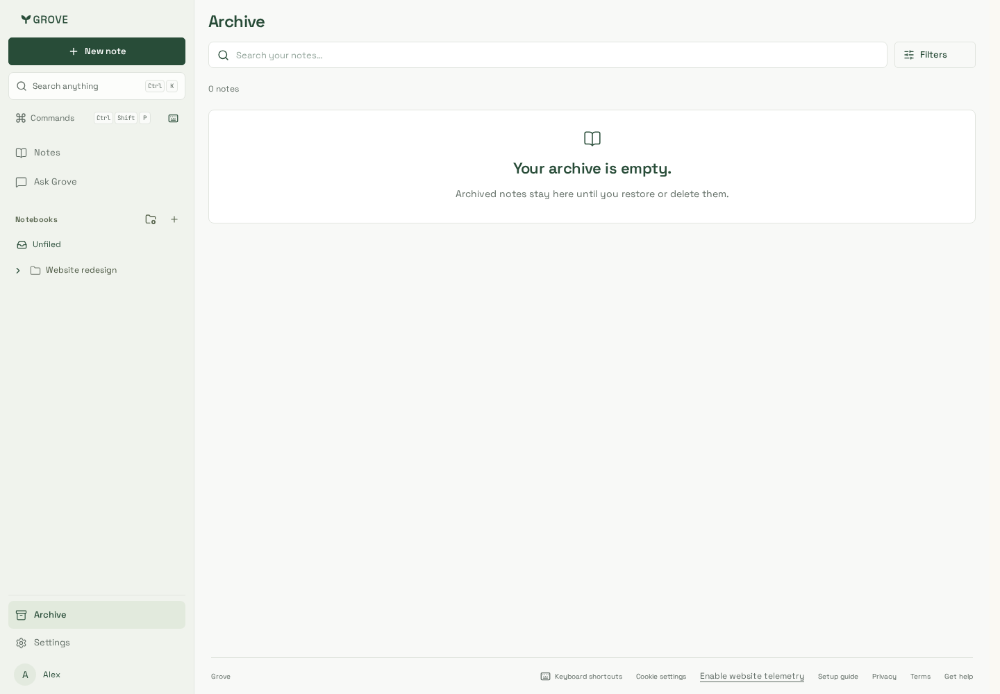    | 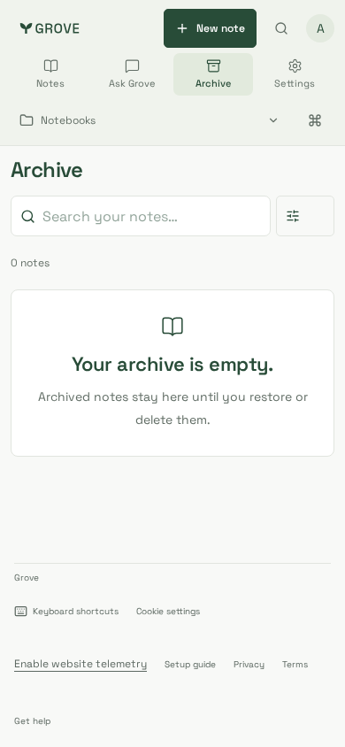    | 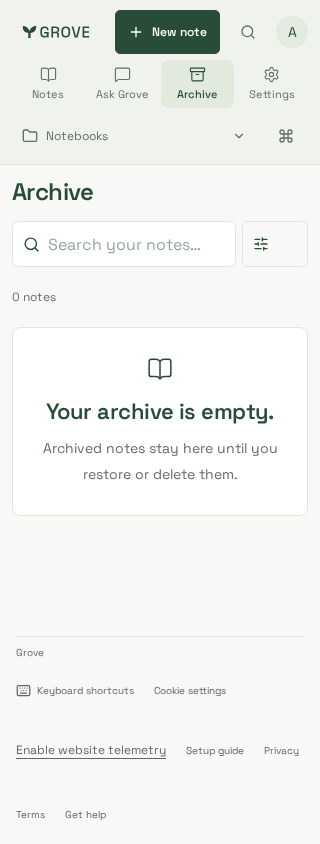    |

Measurements on the Notes list (first note row top): 390px improves from
575px to 403px; 320px likewise. The mobile reader begins at 137px instead of
396px, and now fills the complete 844px viewport. Desktop keeps its rail while
the notebook picker and sort control move into Filters.
