# Structured passage editing and revision review

Captured 5 November 2026 from the integration worktree stacked on core `4775986c`,
with revision grouping added after integration `1d068fd2`, using website build
`bEtEUxeQNcF_gJxU4lkXS`. The source includes uncommitted grouping/security-repair
changes; this is not a deployed release capture. Chromium, synthetic account/note,
1440×960 and 390×960. No production content or model output appears here.

The `structured passage saves and visible revision diffs` browser cases edit only
“working” → “tested”, assert the exact guarded splice (no complete `content` body),
saved focus, retained surrounding source, default latest-previous comparison,
expandable complete versions, no page error/overflow and no scoped WCAG A/AA axe
violations at 1440, 390 and 320 px. The screenshot shows the real shared history
component, not a separate mock. Source markup remains visible in the diff.

| Desktop                                             | Phone                                            |
| --------------------------------------------------- | ------------------------------------------------ |
| 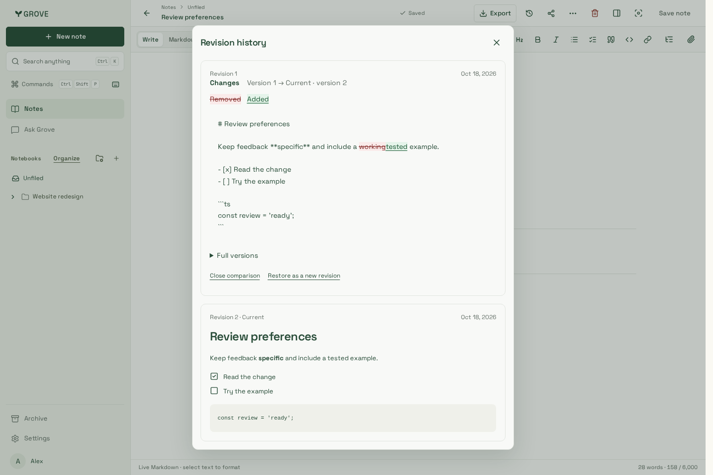 | 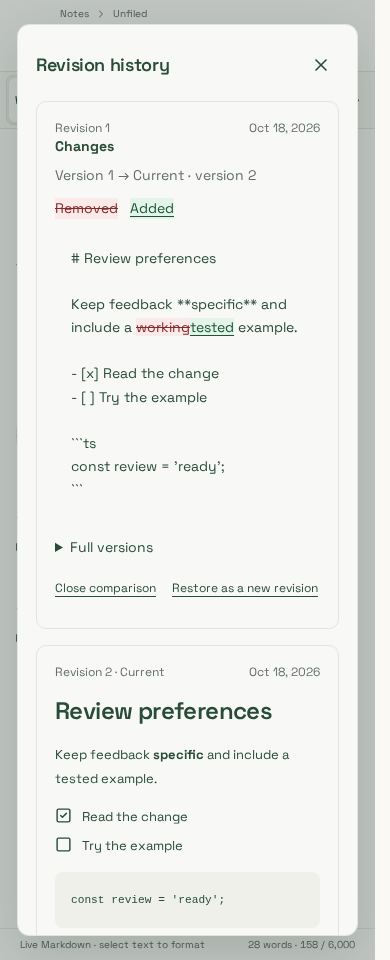 |

The `quick autosaves share one readable revision` cases save two small changes in
one mounted editor session. They assert identical session hints, two immediate
version-fenced saves but only two history rows (original plus combined revision),
both changes in the combined diff, the stable logical revision number and save
count, no overflow/scoped axe violations, and a separate explicit-Save checkpoint.

| Coalesced desktop history                                | Coalesced phone history                               |
| -------------------------------------------------------- | ----------------------------------------------------- |
| 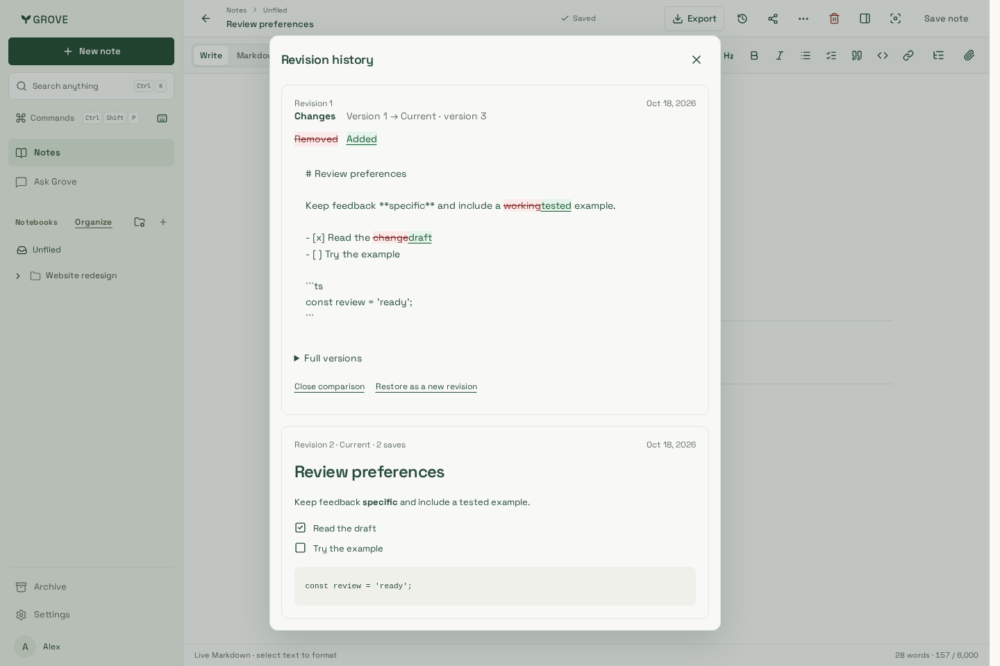 | 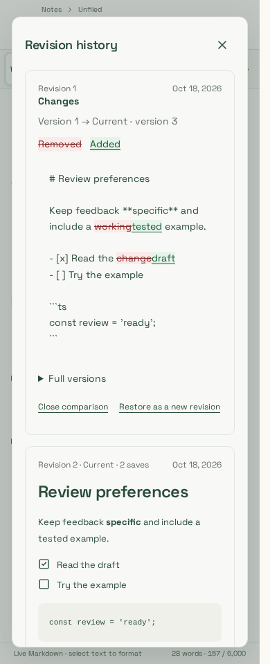 |

Screenshots were visually inspected: the previous revision's source change is
first, with removed/added legend and full-version disclosure; the current rendered
revision follows. Narrow content wraps inside the modal and its source surface.
The modal scrolls vertically when needed. Color is accompanied by text decoration.

Limits: fixture-backed browser transport, not production authentication or a
live-model UI journey. Native-host WebKit lacks system libraries; the matching
Playwright 1.64.1 Noble container, with the host's Node 24.21.0 binary, passed all
67 focused WebKit cases, including source splices, coalescing and explicit saves.
The full Chromium suite passed 277 cases. The retained images are Chromium captures.
No host package installation or physical-device acceptance is claimed. See [the feature contract](../../../structured-documents.md)
and [AI investigation](../../../evaluations/ai-services-2026-11-05.md).

## Production smoke baseline — 26 November 2026

The [reliability implementation design](../../production-reliability.md) must
preserve this already-working passage-review path. This is a **before-fix baseline**,
not a capture of a semantic, freshness or draft-recovery failure.

Captured through authenticated Chromium on production v1.11.37, source
`622ca2b0b5b98801c21166be9d00965f72bfe42d`, production merge
`ee7deafeb072f0ed506260d285c476bba5294cf2`, on 26 November 2026. A clearly
labeled synthetic note was created in the website and precisely edited through
the current OpenCode Grove tools using reviewed preview/apply. The website was
reloaded before opening history: it shows the same version 1 → 2 comparison,
changing only “blue” to “green” and preserving the reference/checklist.

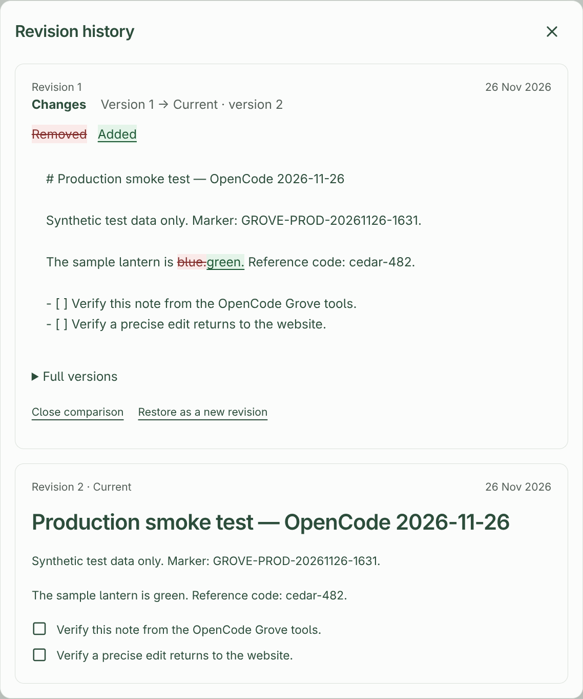

This is an element capture, 1138×1362 pixels; the viewport dimensions were not
recorded, so it is not responsive-layout evidence. It contains only synthetic
authored content and date/version labels—no credentials or private user notes.
It does not establish automatic external-edit freshness, provider health, durable
draft recovery, WebKit or physical-device acceptance. No runtime behavior was
changed to produce this image.

## Internal links — 26 November 2026

Synthetic Chromium captures from `feat/ui-ux-implementation` on parent
`5f8e6ad99b153862a35f4b7706988ae42c7279b0` plus the internal-link implementation,
optimized website build `rtSbT9mBE8I9AuQEuGm2w`. This is local source evidence,
not a deployed release or a replacement for the historical history captures above.
Viewports: 1440×900, 390×900 and short 320×480.

The real Markdown renderer/editor shows separately navigable links and on-demand
native previews, literal custom captions and exact revision/hash destinations.
The Link inspector retains the captured selection, allows a title-following choice
and keeps its actions within the available viewport. All six images were visually
reviewed: preview text remains readable, the inspector fits its content rather than
an empty fixed-height panel, and the checkbox stays beside its label.

| Preview, desktop                                        | Preview, phone                                       | Preview, short phone                                       |
| ------------------------------------------------------- | ---------------------------------------------------- | ---------------------------------------------------------- |
| 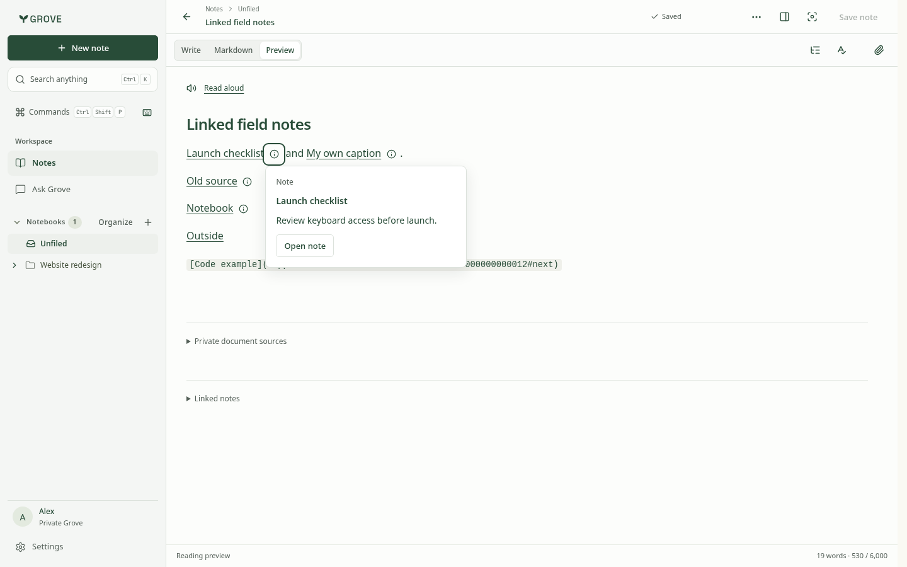 | 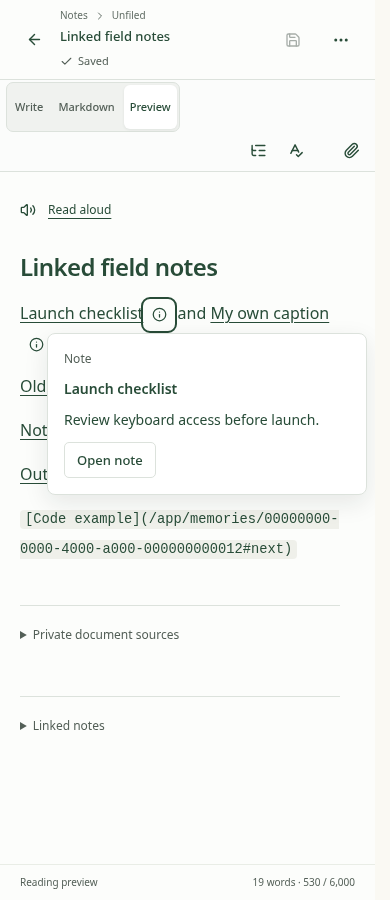 | 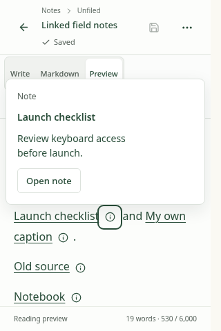 |

| Insert link, desktop                            | Insert link, phone                           | Insert link, short phone                           |
| ----------------------------------------------- | -------------------------------------------- | -------------------------------------------------- |
| 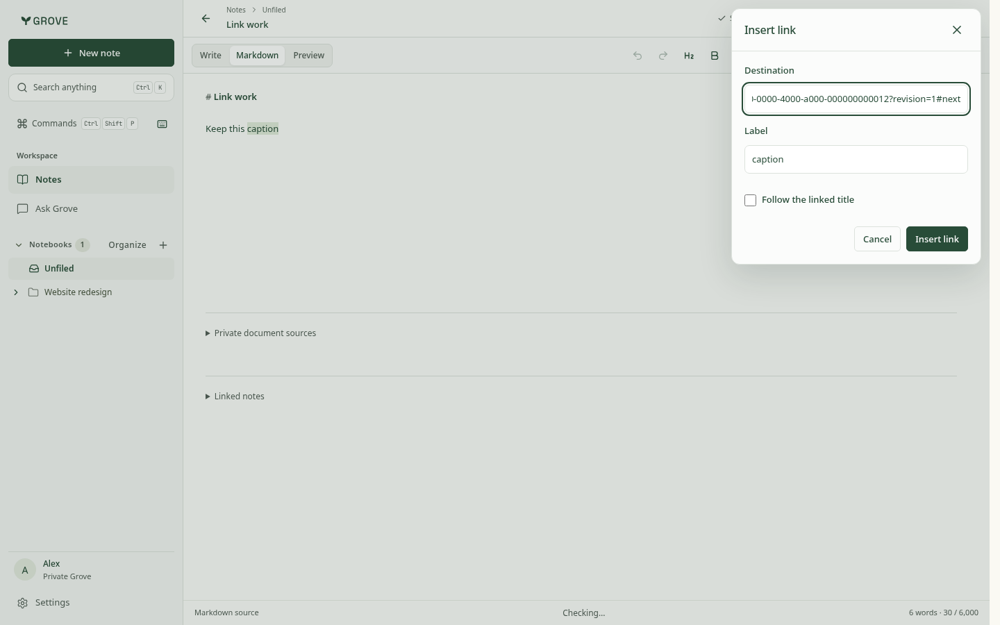 | 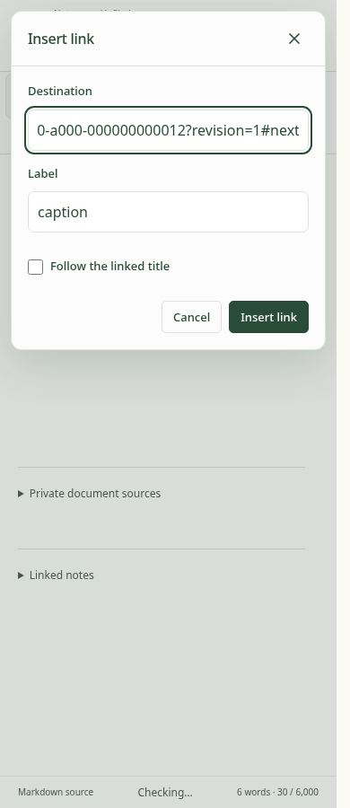 | 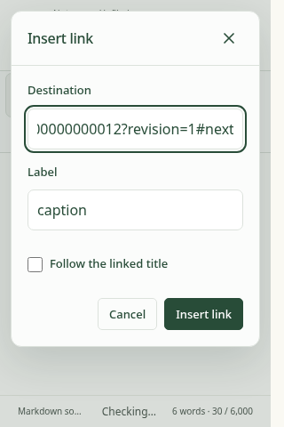 |

Focused checks cover keyboard/Escape/focus, scoped axe, viewport geometry,
on-demand request bounds, held-read cancellation, private-cache invalidation,
transient failure/Retry, source/version fences and isolated Undo/Redo. Public
readers retain source captions without private preview requests. Transport is
fixture-backed; separate real PostgreSQL/API tests cover authorization, lifecycle,
expiry and exact revision reads. These images do not establish authenticated
Next-router, physical-device, screen-reader or live-provider acceptance.
