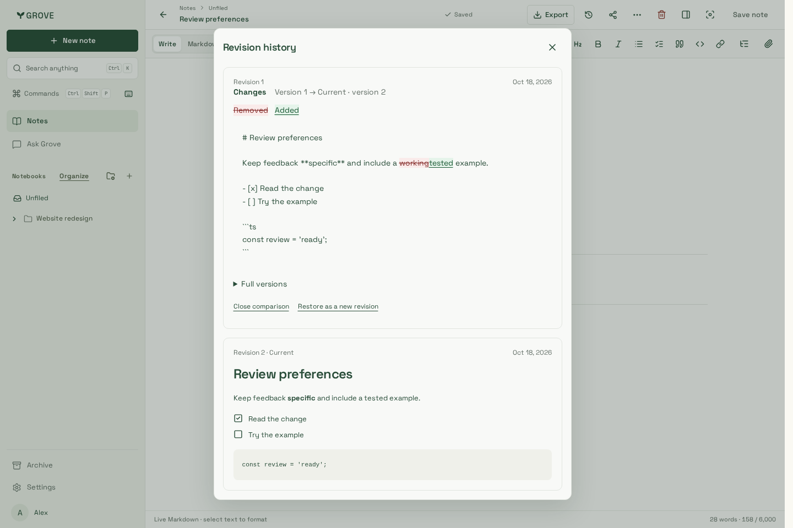
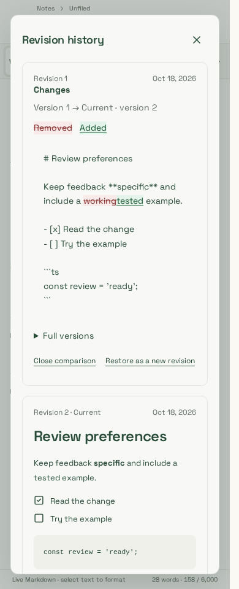
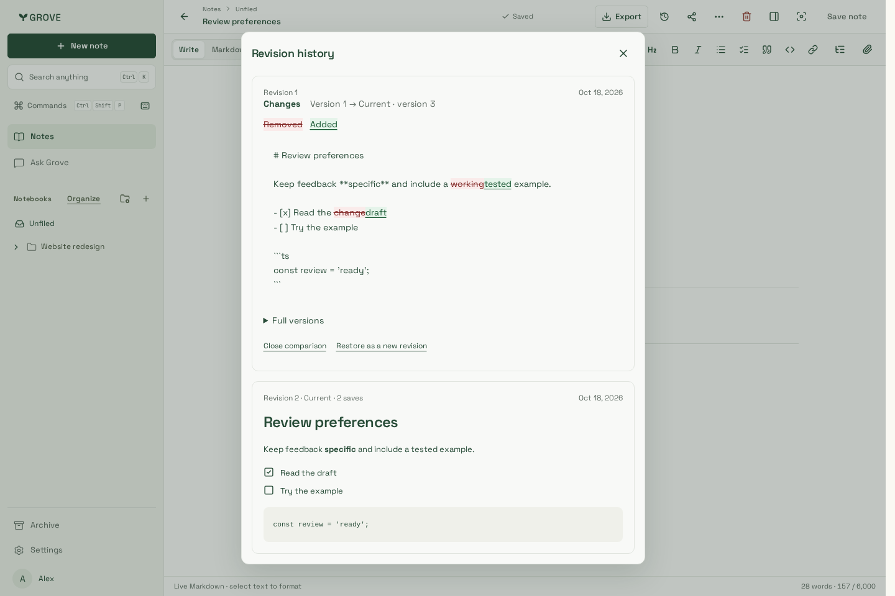
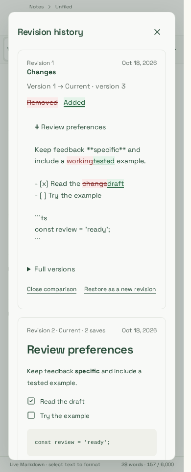

# Structured passage editing and revision review

Captured 5 November 2026 from the integration worktree stacked on core `4775986c`,
with revision grouping added after integration `1d068fd2`, using website build
`bEtEUxeQNcF_gJxU4lkXS`. The source includes uncommitted grouping/security-repair
changes; this is not a deployed release capture. Chromium, synthetic account/note,
1440×960 and 390×960. No production content or model output appears here.

The `structured passage saves and visible revision diffs` browser cases edit only
“working” → “tested”, assert the exact guarded splice (no complete `content` body),
saved focus, retained surrounding source, default latest-previous comparison,
expandable complete versions, no page error/overflow and no scoped WCAG A/AA axe
violations at 1440, 390 and 320 px. The screenshot shows the real shared history
component, not a separate mock. Source markup remains visible in the diff.

| Desktop                                             | Phone                                            |
| --------------------------------------------------- | ------------------------------------------------ |
|  |  |

The `quick autosaves share one readable revision` cases save two small changes in
one mounted editor session. They assert identical session hints, two immediate
version-fenced saves but only two history rows (original plus combined revision),
both changes in the combined diff, the stable logical revision number and save
count, no overflow/scoped axe violations, and a separate explicit-Save checkpoint.

| Coalesced desktop history                                | Coalesced phone history                               |
| -------------------------------------------------------- | ----------------------------------------------------- |
|  |  |

Screenshots were visually inspected: the previous revision's source change is
first, with removed/added legend and full-version disclosure; the current rendered
revision follows. Narrow content wraps inside the modal and its source surface.
The modal scrolls vertically when needed. Color is accompanied by text decoration.

Limits: fixture-backed browser transport, not production authentication or a
live-model UI journey. Native-host WebKit lacks system libraries; the matching
Playwright 1.64.1 Noble container, with the host's Node 24.21.0 binary, passed all
67 focused WebKit cases, including source splices, coalescing and explicit saves.
The full Chromium suite passed 277 cases. The retained images are Chromium captures.
No host package installation or physical-device acceptance is claimed. See [the feature contract](../../../structured-documents.md)
and [AI investigation](../../../evaluations/ai-services-2026-11-05.md).
