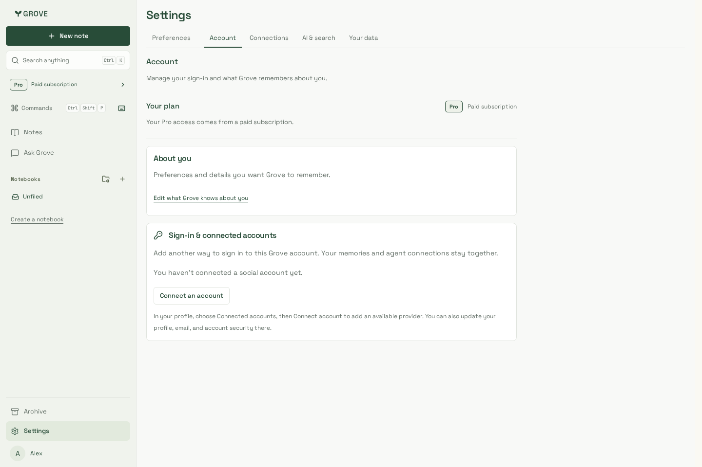
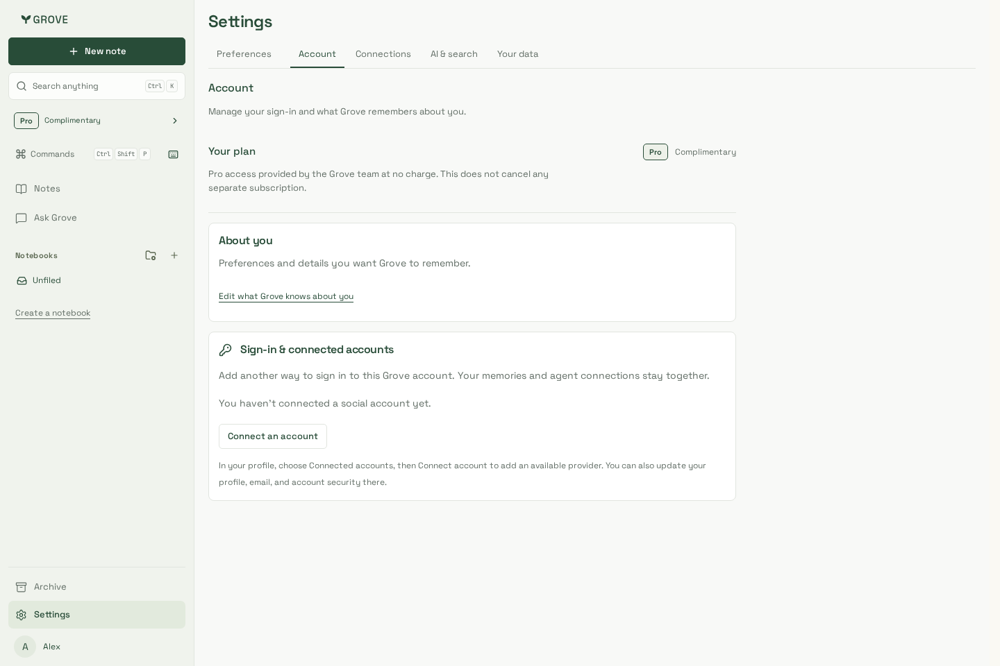
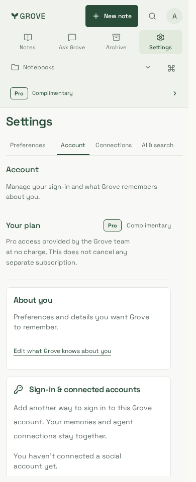
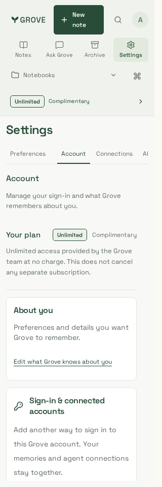

# Subscription badge and access source

Actual workspace/account components with production CSS, synthetic identities and
HTTP responses only. No customer data, real payment or live-provider change.

The outlined tier badge keeps source text visible without hover or color-only
meaning. Selecting the workspace row opens Account plan details even when Billing
is hidden. Existing account typography, palette and notebook navigation are retained.

| Paid Pro, desktop | Complimentary Pro, desktop | Complimentary Pro, phone | Complimentary Unlimited, 320px |
| --- | --- | --- | --- |
|  |  |  |  |

Reviewed Chromium captures at1440/390/320px. Both Chromium and supported Noble
WebKit pass21 synthetic journeys each: all five tier/source combinations across
three widths; keyboard badge→Account navigation,44px targets, WCAG A/AA, no horizontal
overflow/page errors; Billing source/lifecycle separation; load failure/retry,
grant refresh, account switching, null/older-response hiding and refreshed badge
after Billing reconciles a previously Free account. The local WebKit
host lacks ICU/media libraries; verification uses the documented Playwright1.64.1
Noble image with Node24.21.0 instead of changing the workstation.

Production build and final source verification are recorded in
[delivery evidence](../../../delivery.md#visible-subscription-and-complimentary-access-25-october-2026).
