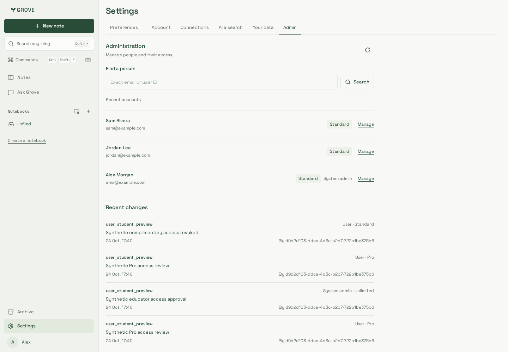
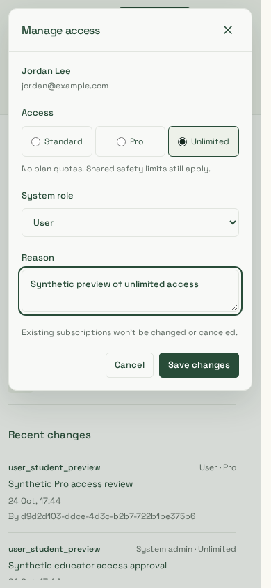
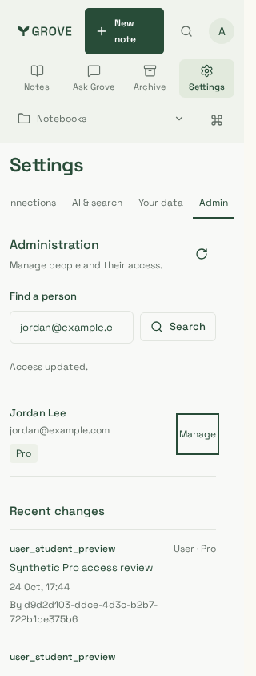
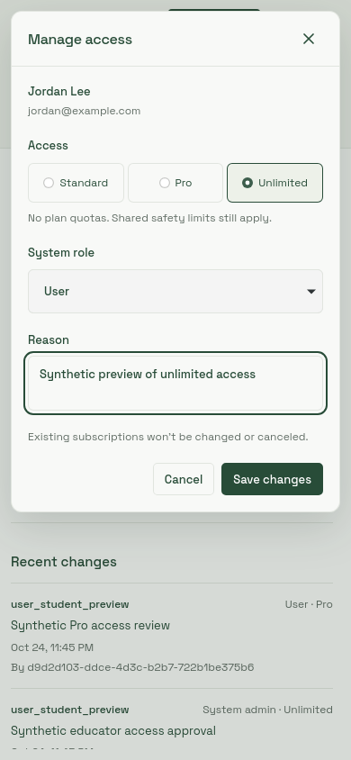
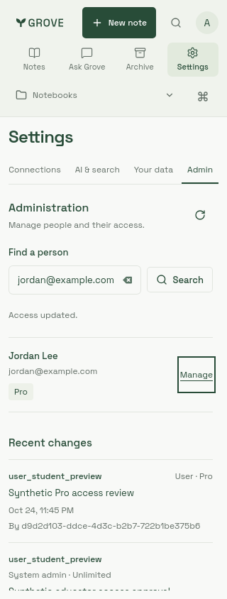

# System administration review

Synthetic accounts only, using the actual AdminPanel, production CSS and local API
with disposable PostgreSQL/non-owner runtime roles. No production account data or
authentication bypass ships with the application. Desktop1440px, phone390px and
narrow320px are reviewed in Chromium and supported WebKit (Playwright1.64.1 Noble
container, Node24.22.1). The final editor includes the shared padded, scrolling
inspector body; both engines pass after this visual refinement.

| Accounts                          | Access editor                                | Narrow layout                         |
| --------------------------------- | -------------------------------------------- | ------------------------------------- |
|  |  |  |

| WebKit accounts | WebKit editor | WebKit narrow layout |
| --- | --- | --- |
|  |  |  |

The journey grants unlimited and Pro, promotes/demotes a synthetic admin, restores
Standard access and verifies one audit event after a lost-response retry with the
identical operation payload. It checks keyboard dismissal, revoked-access
concealment, WCAG A/AA findings, horizontal overflow and page errors. Account state
is real local PostgreSQL; Clerk identity names/session are explicit test fixtures.
Both engines also verify a temporary role-discovery outage hides sensitive rows,
keeps an honest retry and recovers without claiming the admin role was revoked.

No charge, live grant or production rollout is represented by these captures.
