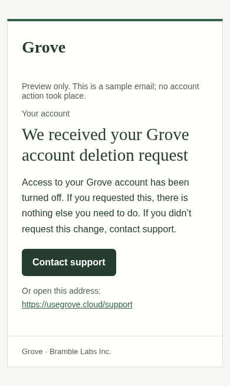

# Transactional email previews

Synthetic letters from the worker's HTML renderer. The preview banner distinguishes these samples from real account events. Captured in Chromium at 390 px (export and deletion) and 620 px (welcome and connections); inbox clients may render them differently.

Source: `packages/api/src/email-template.ts` at `c964c8ad`. Rendered with
`node scripts/testing/email-previews.mjs render DIRECTORY` and captured locally
with images disabled by design (the letters use no remote assets). These are
light-mode browser renders, not Gmail/Outlook compatibility or delivery evidence.

| Export ready | Deletion requested |
| --- | --- |
|  |  |

| Welcome | Connection approved | Connection revoked |
| --- | --- | --- |
|  |  |  |
