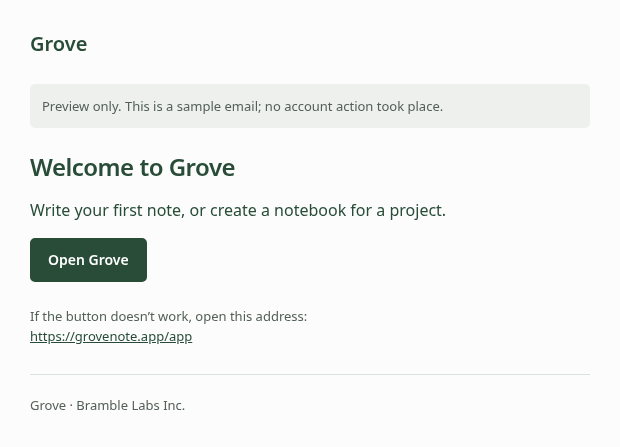
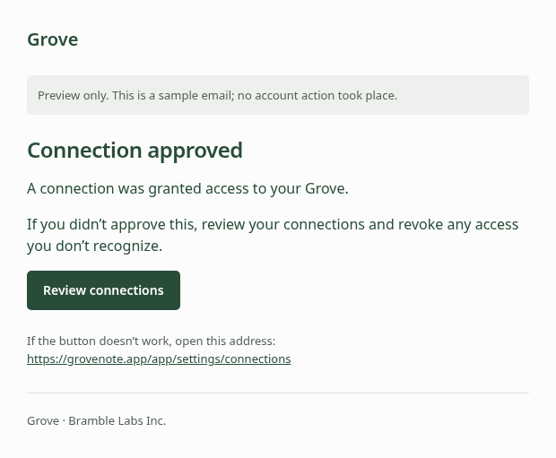
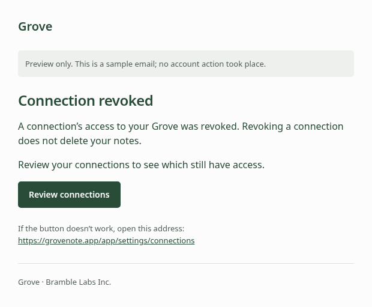
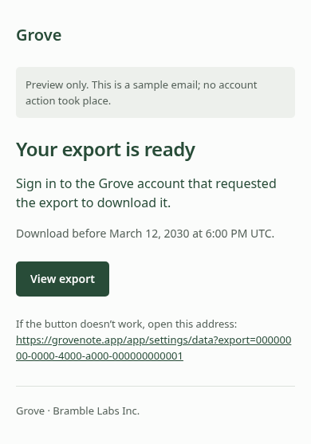
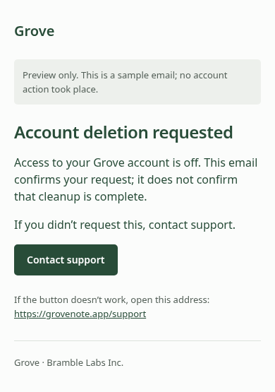
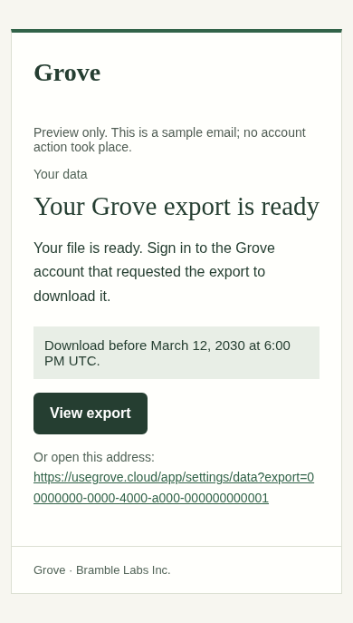
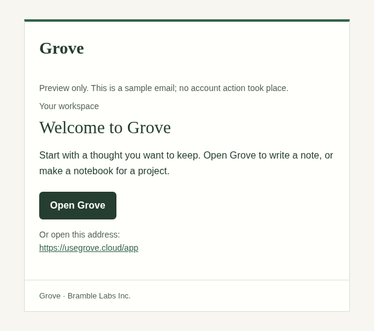
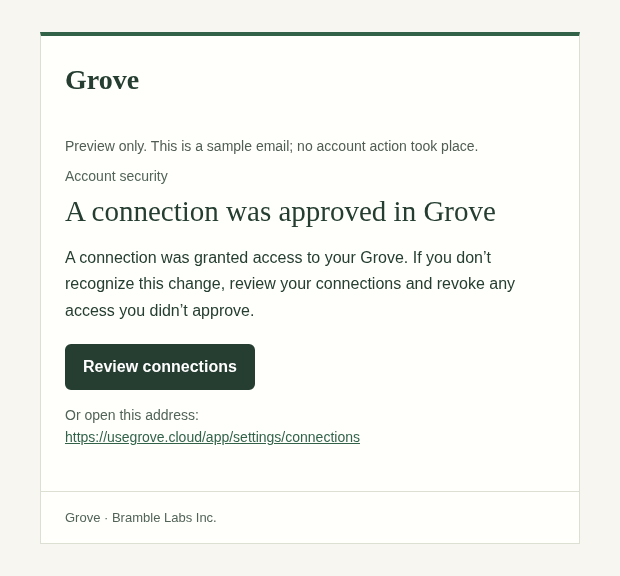
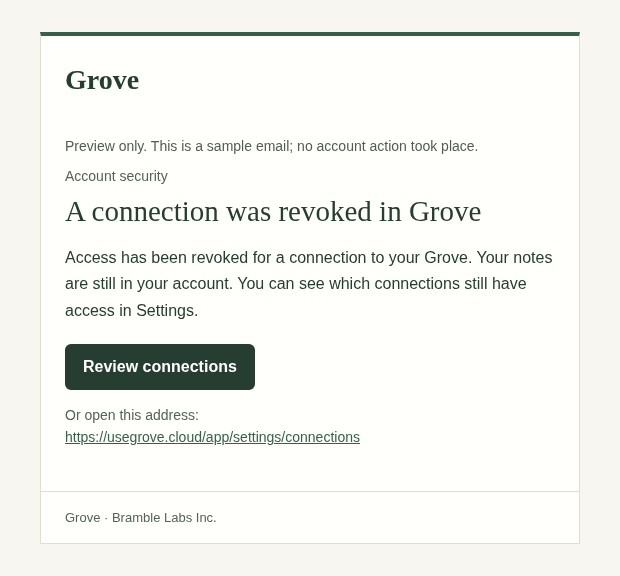

# Transactional email previews

## App-aligned letters — 26 November 2026

Synthetic letters from `packages/api/src/email-template.ts`, based on development
`622ca2b0` / 1.11.37 with the app-aligned renderer. Renderer SHA-256:
`31433a3b378f05058f5c8834ad47ccccf45414c850a01a102ca49276524716f1`.
These are offline samples, not sent mail or account receipts. The visible preview
notice is absent from normal messages. Destinations use the canonical
`grovenote.app`; the export task and 2030 deadline are synthetic.

| Welcome                                                     | Connection approved                                                                 | Connection revoked                                                                   |
| ----------------------------------------------------------- | ----------------------------------------------------------------------------------- | ------------------------------------------------------------------------------------ |
|  |  |  |

| Export ready                                                                  | Deletion requested                                                                                   |
| ----------------------------------------------------------------------------- | ---------------------------------------------------------------------------------------------------- |
|  |  |

Five letters, preview and normal variants, rendered in Chromium at 620/390/320px
(30 styled states): no page errors, horizontal overflow or sampled axe violations;
primary actions measure 44px high and headings use the system interface font at
24px. Tab reaches the primary and fallback links with visible focus. Fifteen
additional stripped-style renders retain the heading, content and links; three
long-link checks have no horizontal overflow. Three dark-preference browser
checks retain legible explicit light colours and report no sampled axe violations.
These checks do not emulate email-client HTML rewriting or forced dark mode.

No remote assets or outbound requests were used. The five selected captures are
cropped only to the measured message-body height, without scaling or removing
content. The historical images below retain their original bytes. Rendering
offline with `node scripts/testing/email-previews.mjs render DIRECTORY` uses the
same worker renderer. Gmail, Outlook, Apple Mail, screen-reader and delivery
acceptance remain separate; no live email was sent.

## Historical design

The earlier cream/serif letters below predate the app-aligned renderer and include
the old website domain. They are retained as before evidence, not current designs
or destinations. The preview banner distinguishes these samples from real account
events. Captured in Chromium at 390px (export and deletion) and 620px (welcome and
connections); inbox clients may render them differently.

Source: `packages/api/src/email-template.ts` at `c964c8ad`. Rendered with
`node scripts/testing/email-previews.mjs render DIRECTORY` and captured locally
with images disabled by design (the letters use no remote assets). These are
light-mode browser renders, not Gmail/Outlook compatibility or delivery evidence.

| Export ready                                            | Deletion requested                                                   |
| ------------------------------------------------------- | -------------------------------------------------------------------- |
|  |  |

| Welcome                                       | Connection approved                                           | Connection revoked                                      |
| --------------------------------------------- | ------------------------------------------------------------- | ------------------------------------------------------- |
|  |  |  |
