# UI/UX review evidence

26 November 2026. [Findings and proposed direction](../../review/ui-ux.md).
These are **before** captures, not redesign previews.

## Web workspace

Development `622ca2b0b5b98801c21166be9d00965f72bfe42d`, product 1.11.37.
Actual components in the existing isolated dashboard fixture, built production
CSS, system UI text and synthetic notes/account/API responses. The ten initial
workspace viewports below are 900px tall; follow-ups state their own sizes.
No real account content, provider calls or production authentication.

| Notes, desktop                     | Notes, tablet                    | Notes, phone                     | Notes, narrow phone              |
| ---------------------------------- | -------------------------------- | -------------------------------- | -------------------------------- |
|  |  |  | 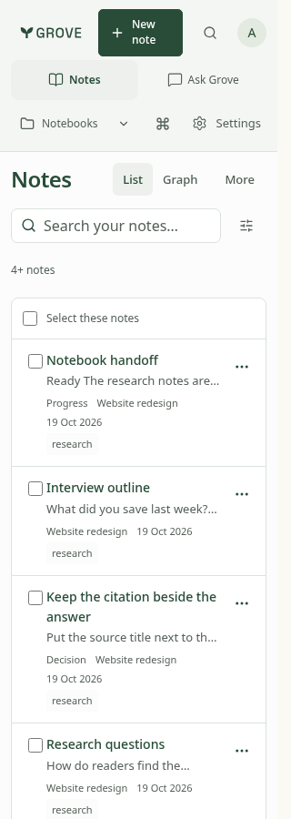 |

The 320px list uses progressive loading; “4+ notes” is the loaded count, not an
incorrect claim that the synthetic library contains only four notes.

| Editor, desktop                      | Editor, phone                      | Ask, desktop                         | Ask, phone                         |
| ------------------------------------ | ---------------------------------- | ------------------------------------ | ---------------------------------- |
|  |  |  |  |

| Writing settings, desktop                        | Writing settings, phone                        |
| ------------------------------------------------ | ---------------------------------------------- |
| 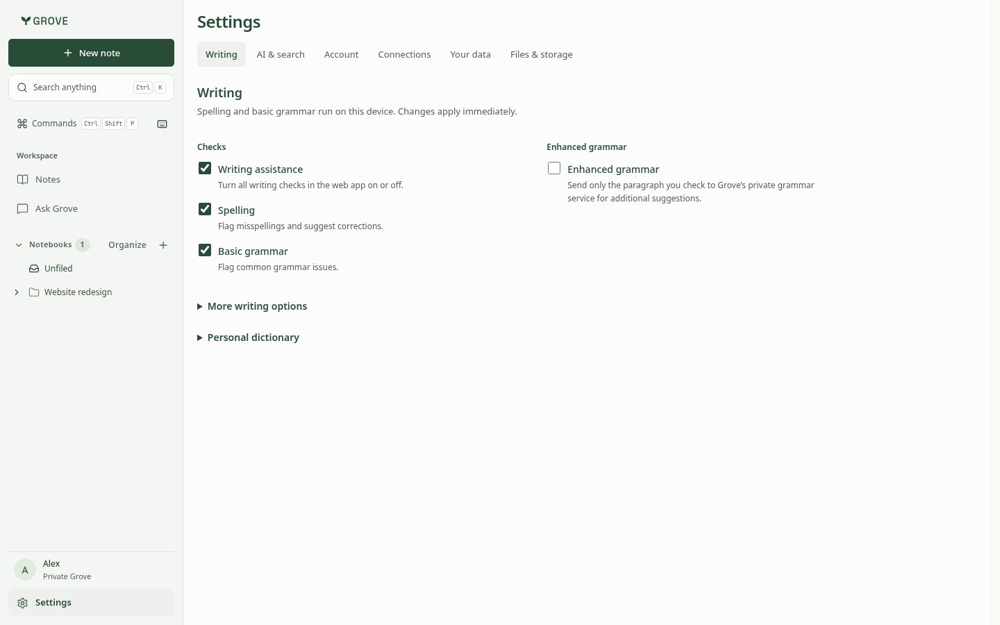 |  |

No horizontal page overflow or JavaScript page errors in these ten states.
Axe findings and their qualification are in the review; no full accessibility,
physical-device or production journey acceptance is claimed. The editor’s transient
Checking state is not proof of finished proofing or production service health.

## Extension

Same source, locally built Chrome package installed in isolated Chromium
156.0.8078.4 with mocked account/API/model responses. The synthetic example sentence
comes from the existing test fixture, not account data. Notes/Settings are 390×844;
writing alternatives are 320×480. A diagnostic capture changed only the test
navigation to expose Notes/Settings, not product code.

| Notes                                              | Settings                                                  | Writing alternatives                                                                       |
| -------------------------------------------------- | --------------------------------------------------------- | ------------------------------------------------------------------------------------------ |
|  | 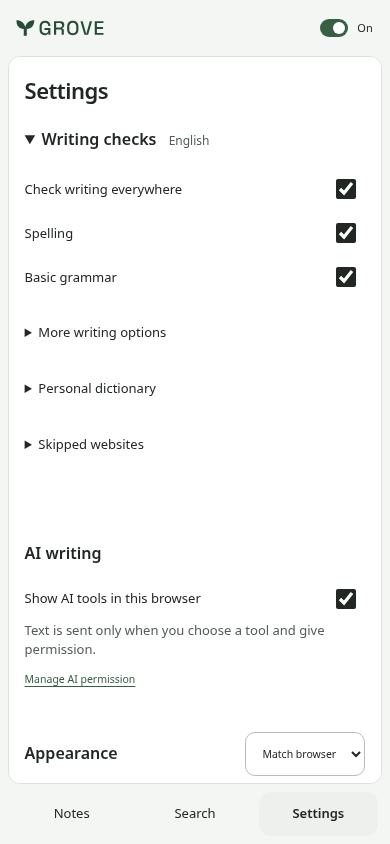 |  |

The host test initially failed a short-viewport geometry assertion; a fresh
unmodified Chrome run passed. The intermittent observation remains in the review.
This is not a full cross-browser installed-suite pass. No live AI, native
permission prompts or cross-store/browser-version parity is claimed.

## Broader workflow evidence

Same source/build and synthetic fixture boundaries as above. The broader run
captured 23 web states at 1440/390×900 with no page overflow or JavaScript page
errors. Six focused phone captures additionally cover deletion cancellation,
export options, uncommitted public-sharing selection, import entry, scrolled file
failure and stale notes. Those six also had no overflow or page errors; axe was
run on the 23-state set, not the focused interaction set.

Selected captures follow; the full temporary capture set is not shipped. Desktop
axe repeats the shell accessible-name mismatches described in the review.

| Expanded Writing, desktop                                                                          | Expanded Writing, phone                                        |
| -------------------------------------------------------------------------------------------------- | -------------------------------------------------------------- |
| 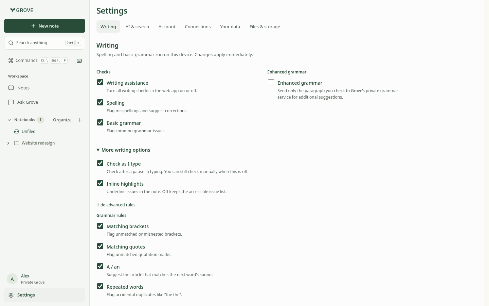 | 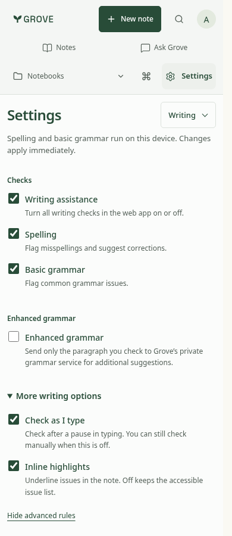 |

These two additional captures open More writing options and advanced rules without
changing a setting. Both have no horizontal page overflow; no additional axe or
page-error measurement is claimed for this small disclosure-only run. They show
why parent/child grouping and balanced layout matter more than adding dividers.

| Notebooks                                            | Real relationship graph                           | AI settings                                    | Files                                       |
| ---------------------------------------------------- | ------------------------------------------------- | ---------------------------------------------- | ------------------------------------------- |
| 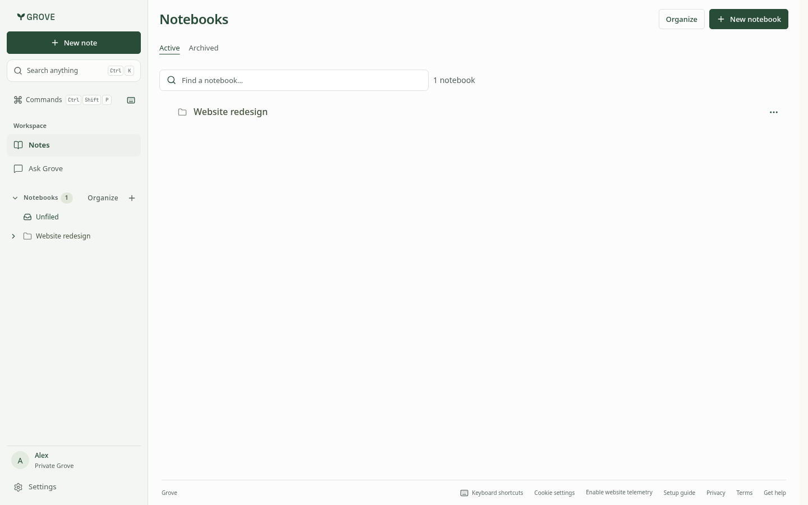 | 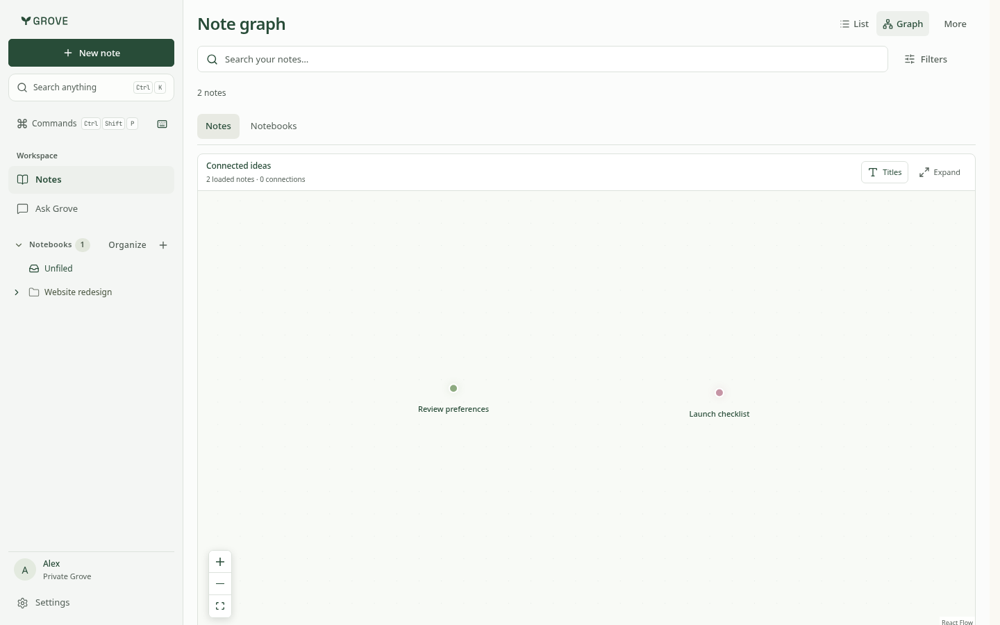 | 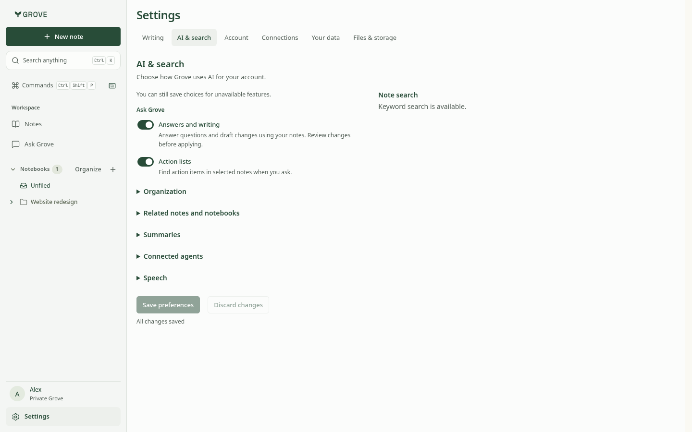 | 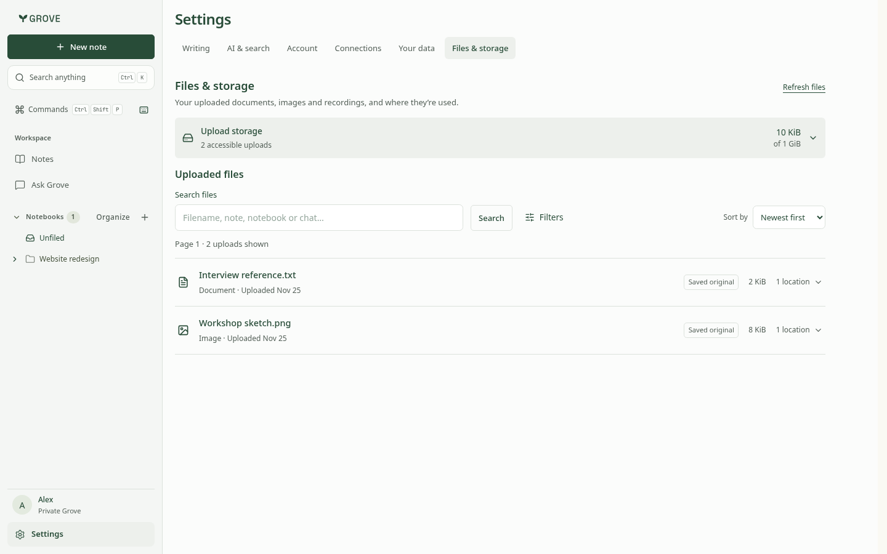 |

| Connections                                                                        | Pending browser approval                                                                       | Pending agent approval                                                        | API-key scope                                                    |
| ---------------------------------------------------------------------------------- | ---------------------------------------------------------------------------------------------- | ----------------------------------------------------------------------------- | ---------------------------------------------------------------- |
| 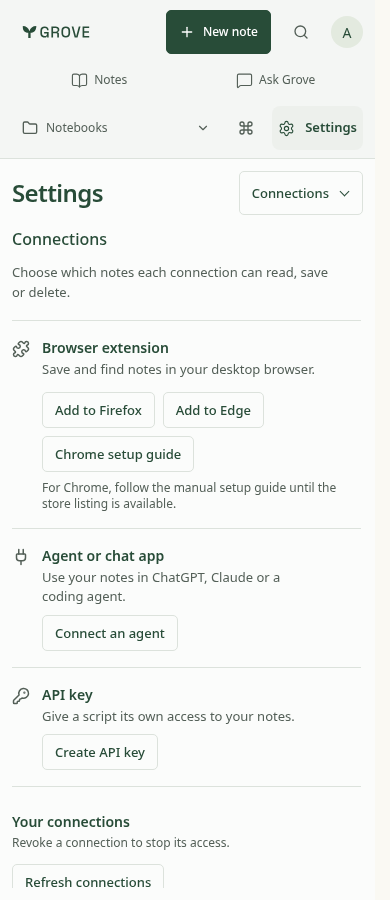 | 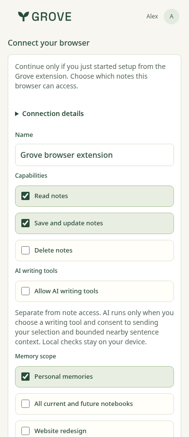 | 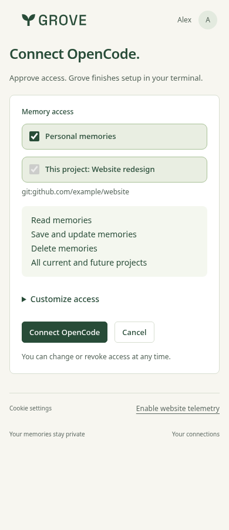 | 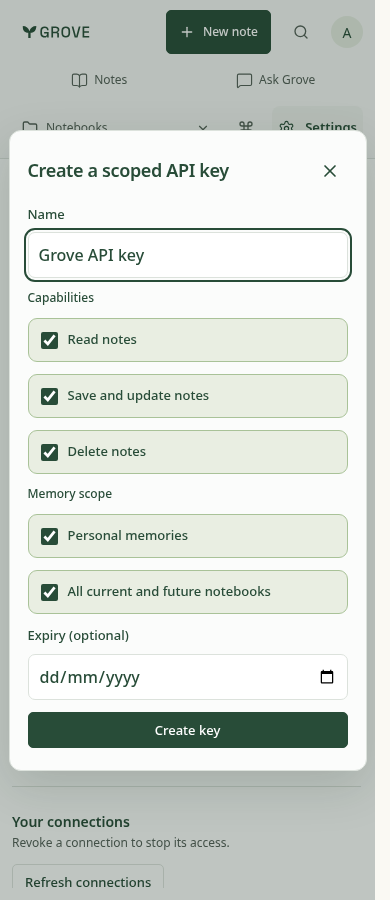 |

Browser approval is seeded with an empty-capability pending connection, **not** an
already-approved receipt. Browser, agent and API-key defaults differ. No approval,
key creation or revocation was submitted.

| Note deletion                                                                | Stale notes                                                                                           | File refresh failure                                                                      | Public-sharing selection                                                   |
| ---------------------------------------------------------------------------- | ----------------------------------------------------------------------------------------------------- | ----------------------------------------------------------------------------------------- | -------------------------------------------------------------------------- |
| 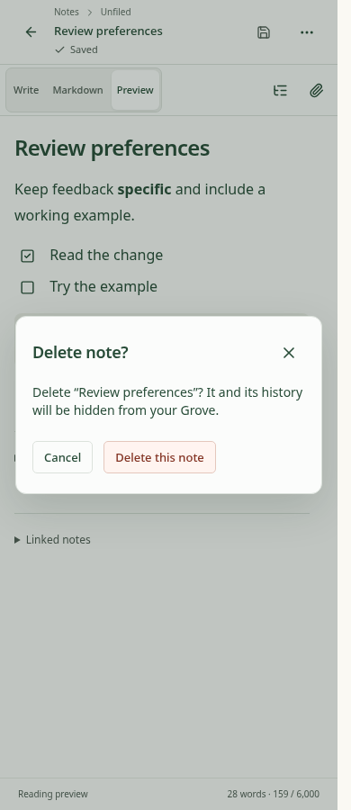 | 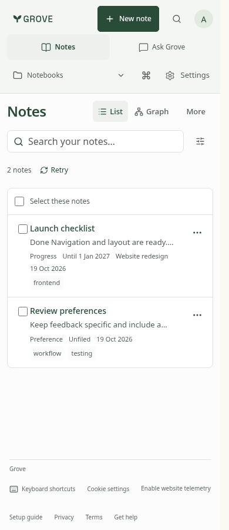 | 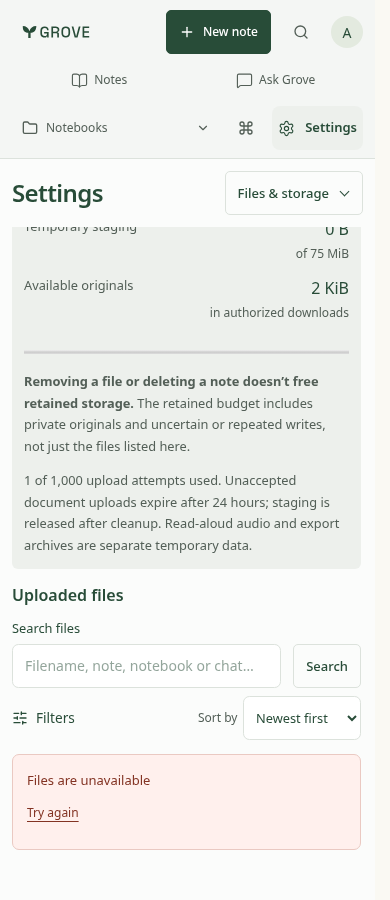 | 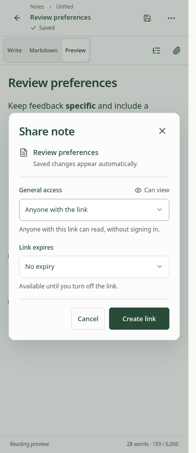 |

The deletion dialog initially focused Cancel and was cancelled. Note-row opening
left the URL at `/app`; reload returned to the list without the detail dialog.
The induced stale-note refresh kept two rows. With storage expanded, the file
failure alert began around y=1002 in a 900px viewport at scroll 0, and loaded file
rows disappeared; the image deliberately scrolls to the actual alert rather than
presenting an unchanged top viewport as evidence. No API mutations were attempted
in these focused interactions. The synthetic failure is not a live outage.

| Import entry                                                                           | Note export options                                                          | Extension Search                                                          | Extension reader                                           |
| -------------------------------------------------------------------------------------- | ---------------------------------------------------------------------------- | ------------------------------------------------------------------------- | ---------------------------------------------------------- |
| 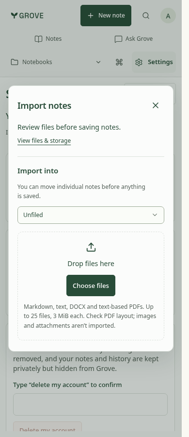 | 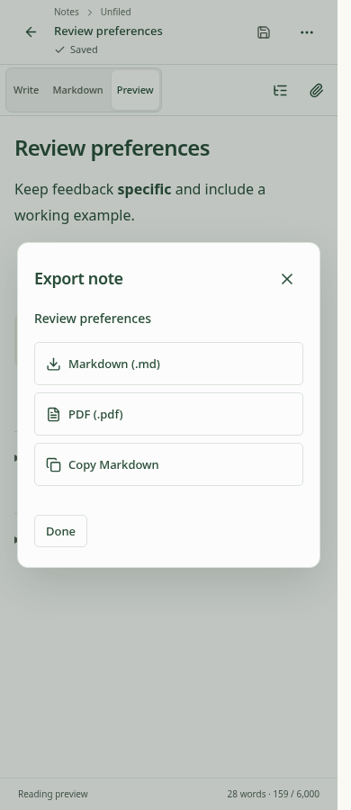 | 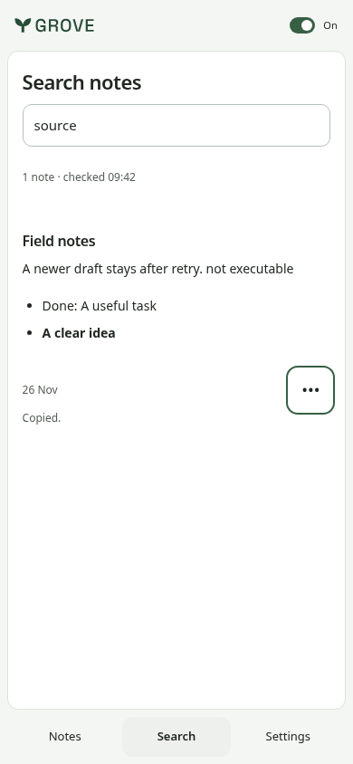 | 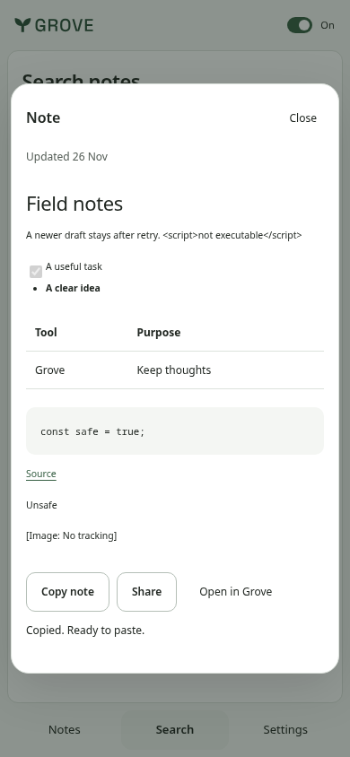 |

The extension additions are 390×844 captures from the unmodified Chrome host
suite, same isolated Chromium version and mocked HTTP/models. The synthetic
`<script>` text, “Unsafe” link and “No tracking” image fallback are deliberate
sanitization fixtures, not product copy or real account content. Copied receipts
reflect preceding test actions. Selected Chrome- and Edge-package host cases
passed on Chromium; this does not establish branded Edge/Firefox, native prompts,
real models, published store versions or production acceptance.

Import entry was closed without choosing files; export options were closed
without preparing/downloading a file; sharing was closed without Create link.
Worker completion, download integrity, live publication and erasure are untested.

## Cross-screen and empty-state evidence

Same product snapshot and production CSS. Ten new captures use isolated synthetic
contexts at 1200/768/390×900, 390×600 and 320×480. No horizontal page overflow or
JavaScript page errors in the completed runs. The owner’s supplied empty-state
crop informed the display review; the images below are independently reproduced
fixtures, not that crop or a claim about its viewport/zoom.

| Empty Unfiled, tablet                                                                          | Empty Unfiled, phone                                      | Actual unmatched search                                          | Empty library control                                                             |
| ---------------------------------------------------------------------------------------------- | --------------------------------------------------------- | ---------------------------------------------------------------- | --------------------------------------------------------------------------------- |
| 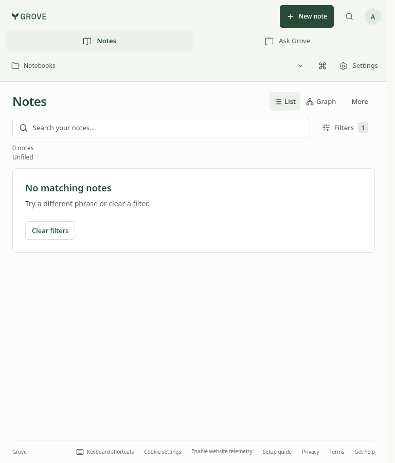 | 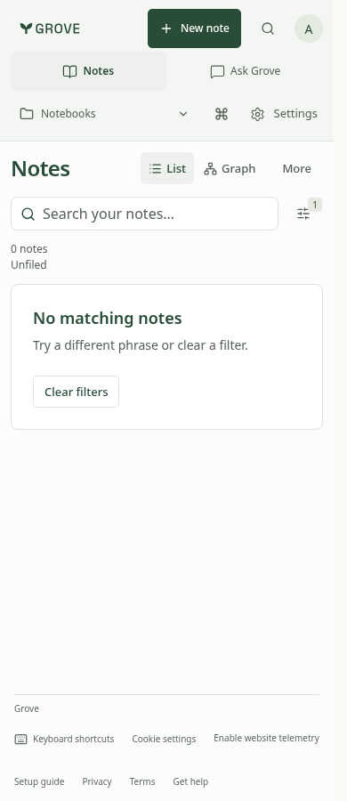 |  | 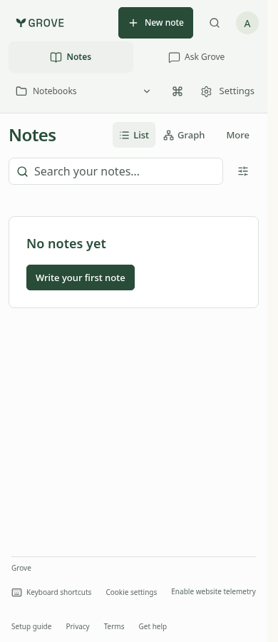 |

An empty Unfiled scope displays “No matching notes” without a query. Clear filters
removes the scope and shows a seeded notebook note, but leaves
`?notebook=personal` in the URL. Reload restores the empty Unfiled view. Search
focus is restored after clearing. The genuinely empty all-notes case has a
different, useful first-note action. No note was created.

| Chat link from Files                                                  | Same chat opened through History                                            | Unsaved AI preference                               | Local master off                                                               |
| --------------------------------------------------------------------- | --------------------------------------------------------------------------- | --------------------------------------------------- | ------------------------------------------------------------------------------ |
| 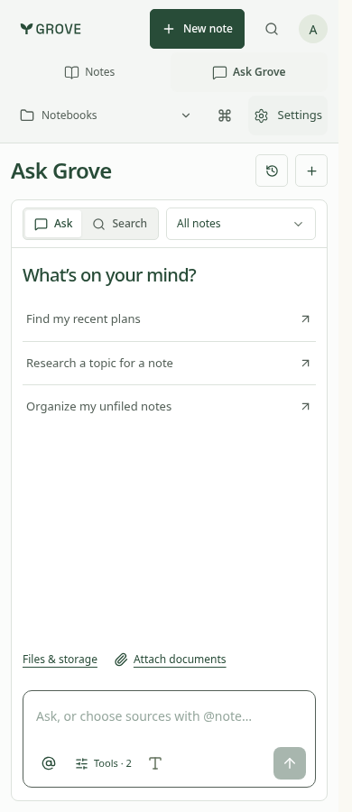 | 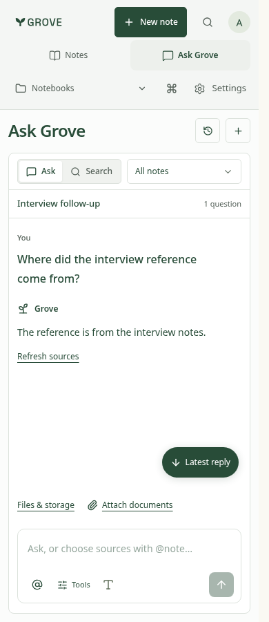 | 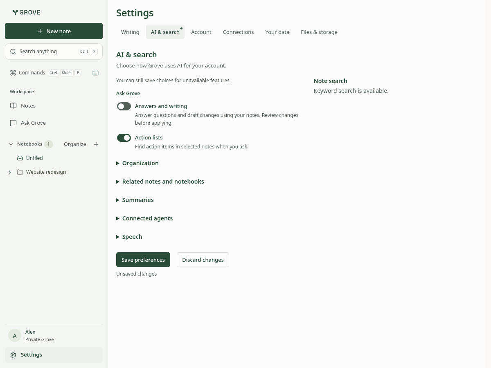 | 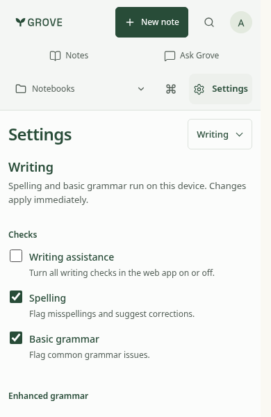 |

The Files link sets `?chat=<id>` but makes no read of that chat. History does read
and display it, while leaving the URL at `/app/ask`; full reload loses selection.
The note counterpart’s in-app Back action returns to `/app`, not its Files origin.
The AI draft survives Writing→AI navigation within Settings, but is lost after
Notes→Settings. No preference save was submitted. The local Writing master was
changed only in disposable browser storage and remains off after reload; the
checked children are saved choices, not evidence of active proofing.

| Short-viewport nested picker                                                    | Tablet subview                                                 |
| ------------------------------------------------------------------------------- | -------------------------------------------------------------- |
| 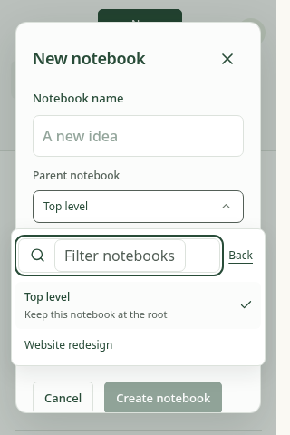 | 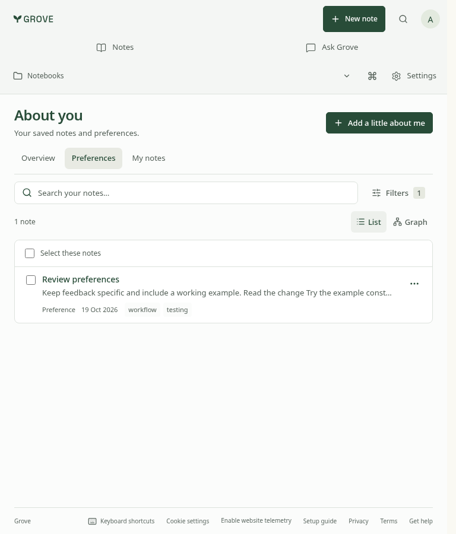 |

Nested Escape returns focus to Parent notebook, then the dialog opener. Tab
sampling reaches BODY at the browser-focus boundary; no full focus-trap claim.
The Preferences subview reloads to Overview at the same URL. Axe on these two
states flags Top level / Filters accessible-name mismatches; the 390×600
master-off state has no axe findings. Axe was not run on the other seven captures.

Navigation uses the existing test Link/history shim, not the real Next router.
Source inspection and full reload support the findings; real Next cache/history,
mobile keyboard, pinch zoom and authenticated production remain unverified. API
reads are synthetic; automatic `POST /briefs` attempts while loading About you
were blocked, not accepted jobs. No remote effects, generation or account edits.
An initial missing documents-list fixture was corrected before retaining the
History screenshot; its temporary error was not recorded as a product defect.

### Menus, alignment and searchable selects

The owner’s Linear and Grove crops inform the icon/layout comparison. Six
additional fixture captures inspect More, Filters and Source at 768/390×900;
four are retained below. No page overflow or JavaScript page errors; axe was not
run on this set. Local menu opening/search did not save a preference or submit
an account command.

| More actions                                                   | Phone filters                                                                       | Source choices, tablet                                                | Source choices, phone                                                   |
| -------------------------------------------------------------- | ----------------------------------------------------------------------------------- | --------------------------------------------------------------------- | ----------------------------------------------------------------------- |
| 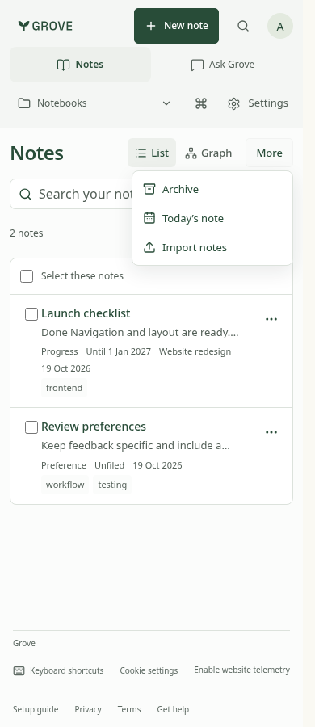 | 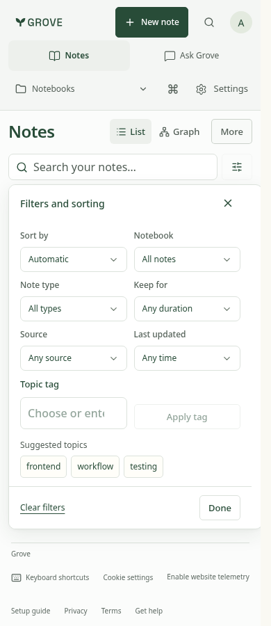 | 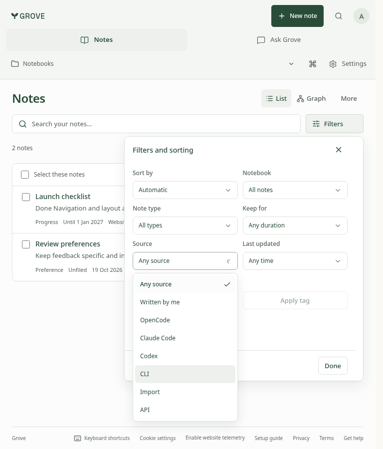 | 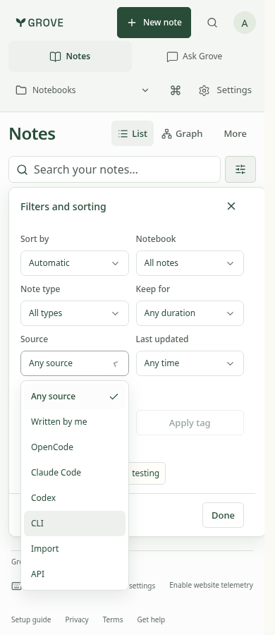 |

Fine-pointer More rows share a 36px height and icon x-position; they are not evidence of ragged
alignment or missing icons. The settled tablet filter panel is 480px wide at
x=249 in a 768px viewport; initial pre-placement geometry was not used as a
clipping finding. Source exposes eight options, no input. Phone keyboard
typeahead focuses CLI without filtering the list. The separate Notebook picker
does expose Filter notebooks and narrows “Website” to Website redesign. These are
different control capabilities, not one universal search defect. Search policies
and grouping/alignment recommendations are in the review.

### Component sizing and input mode

Five additional contexts compare fine pointer at 1440/768/390px with coarse/touch
emulation at 390/320px, all 600px tall. Notes, menu, Writing settings and empty
Unfiled were measured in each. No page errors; measured Notes/Settings pages had
no horizontal overflow. No axe or physical-device acceptance is claimed.

| Coarse-pointer Notes                                            | Coarse-pointer More menu                                                         |
| --------------------------------------------------------------- | -------------------------------------------------------------------------------- |
| 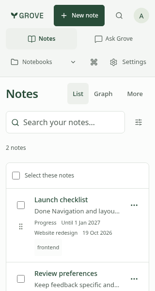 | 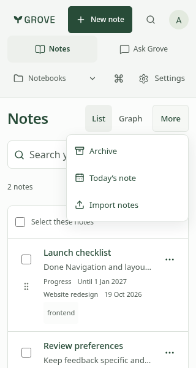 |

The coarse contexts confirm the active media query, not just a narrow viewport.
More rows expand from 36 to 44px; row checkbox labels expand to 44×44px around 16px
glyphs. Writing rows expand with wrapped copy; menu glyphs remain 16px. Earlier
390px captures with a mouse are not evidence that touch expansion failed. The
review’s sizing table records density and panel proportions as well as hit areas;
it does not recommend shrinking all controls or scaling every icon up.

### Sidebar/account and notebook menu follow-up

Owner-supplied crops prompted this check; their capture zoom/scale is unknown.
New evidence uses actual components and the same production CSS/product snapshot,
ten synthetic notebooks and synthetic Pro usage. Allowance constants come from
source; used counts are illustrative, not the owner’s account. The Clerk avatar
is the existing test stub, so actual account-menu behavior is not assessed.

| Sidebar controls                                                        | Expanded plan details                                             | Notebook actions                                                  | Short touch menu                                                                  |
| ----------------------------------------------------------------------- | ----------------------------------------------------------------- | ----------------------------------------------------------------- | --------------------------------------------------------------------------------- |
| 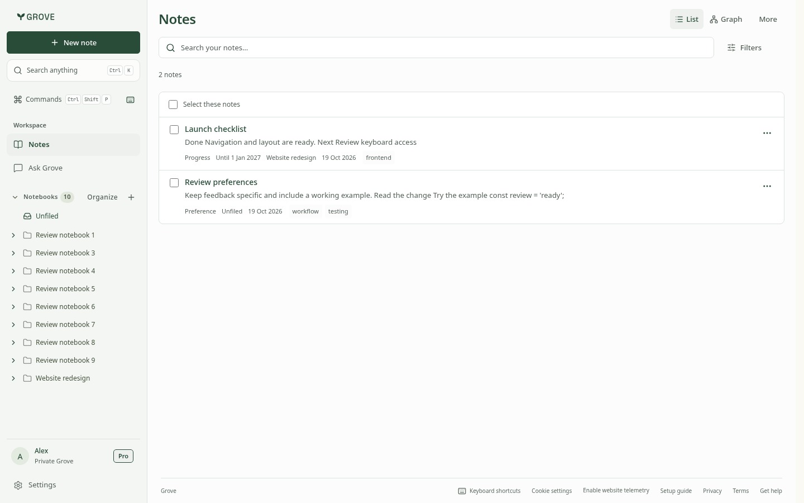 | 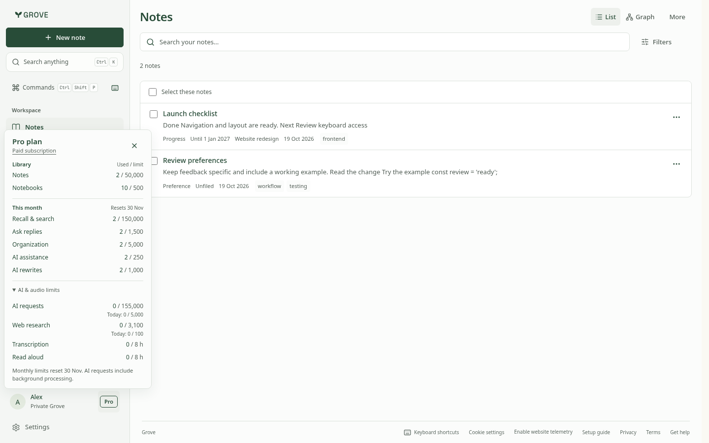 | 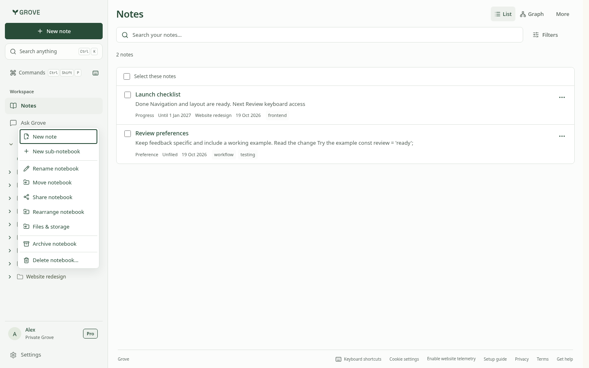 | 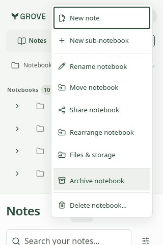 |

| Failed usage read                                                                                  |
| -------------------------------------------------------------------------------------------------- |
| 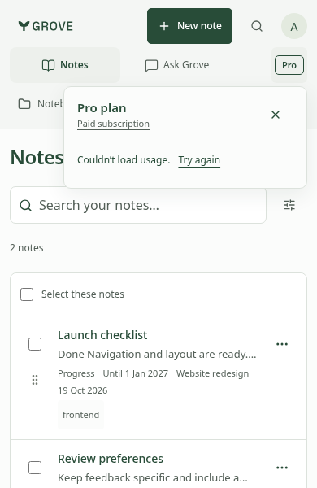 |

Five contexts: fine pointer 1440×900, 1440×600, 1024×600; coarse input 390×600,
320×480. All had no page errors or horizontal overflow. Menu rows measure 36/44px
with aligned icons; End reaches Delete and Escape returns to the trigger. Move
and Rearrange open different dialogs; cancelling each returns focus in the desktop
sample. Expanded plan details scroll within the 320×480 viewport. No grant,
purchase, notebook move/reorder, archive or deletion was submitted. No axe,
physical-device, real Clerk-menu or production acceptance is claimed.

### Loading and skeleton follow-up

Same source/build; controlled fine-pointer 1440×900 and coarse-input 390×844
contexts with six synthetic notes, initially exposing four via progressive
loading. The session shell is separately forced with `fixtureOpening=1`; it does
not measure Clerk readiness or prove a real authentication transition. The list
read is deliberately held for 1,200ms, not a production latency benchmark.

| Forced session shell                                            | Data-pending list                                               | Initial loaded rows                                                                    | Failed refresh                                                                                               |
| --------------------------------------------------------------- | --------------------------------------------------------------- | -------------------------------------------------------------------------------------- | ------------------------------------------------------------------------------------------------------------ |
| 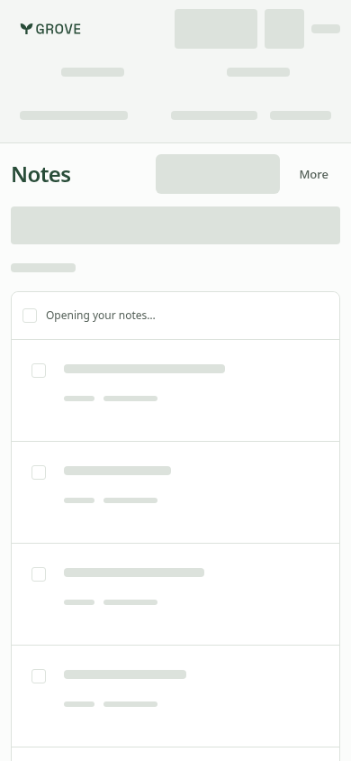 | 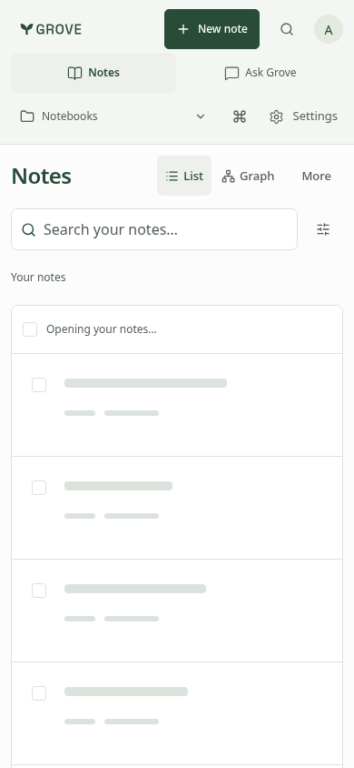 | 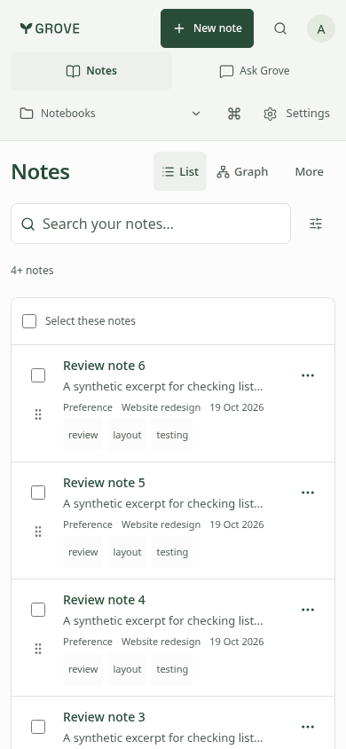 | 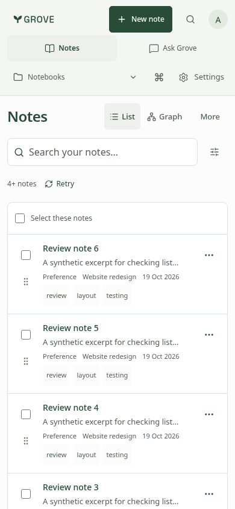 |

Phone list tops differ between forced shell and pending list (323/335px);
sampled pending/loaded row heights are 112/about 131px. Desktop equivalents are
160/164px and 85/about 94.5px. These comparisons are not production CLS or a
complete long-title/all-row check. Warm Settings→Notes returns add no note reads
or skeletons in either context. Held refreshes keep the same mounted first row,
focus and sampled geometry without a skeleton; the indicator starts hidden and
is visible after 450ms, consistent with the existing 350ms CSS delay. On failure,
the screenshot visibly shows Retry; the detailed freshness explanation remains
screen-reader-only. No page errors, horizontal overflow or blocked effect
attempts were recorded. No axe, real Safari chrome/pull-to-refresh, physical-device
or production timing acceptance is claimed.

## Refined finder, history, billing and source-reading evidence

Same product snapshot and production CSS. Four contexts cover 13 states each
(52): fine pointer 1440×900 / 768×700, coarse input 390×700 / 320×480. Three
focused contexts at 1440/390/320px additionally diagnose caption geometry,
verify an unsent finder→Ask draft/scope handoff and inspect billing failure
placement. Synthetic Pro limits come from source; usage, overdue payment and
pending counts are illustrative, not the owner’s billing data. The selected
billing captures use three stored notes (two active, one archived) and one notebook.

| Finder results                                                  | Refining the phrase                                                                             | Long saved comparison                                                                                      | History read failure                                                                   |
| --------------------------------------------------------------- | ----------------------------------------------------------------------------------------------- | ---------------------------------------------------------------------------------------------------------- | -------------------------------------------------------------------------------------- |
| 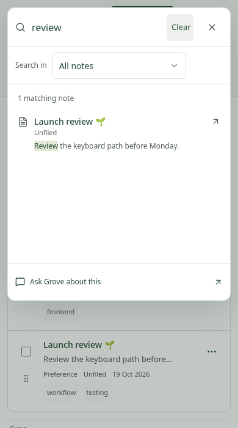 | 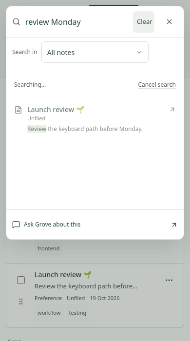 | 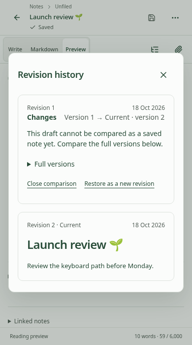 | 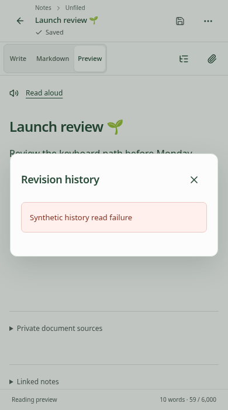 |

The finder’s caption grows 34→60px, moving the retained first result down 26px
in every context while the outer dialog stays fixed. Cancel search retains its
44px target; a discarded DOM-only 60px caption reservation removes the movement
at 1440/390/320px. Earlier results settle at 0.55 opacity while refining. This is
a diagnosis, not a shipped fix. Cancel keeps the phrase, retry/scope broadening
return focus to the field, and Escape returns to the launcher; reopening resets
query/scope. Normal emoji-containing saved versions compare and expose full
versions correctly. Only the separately seeded earlier text over 6,000 characters
produces the misleading draft fallback. History failure has no Retry in all four
contexts; no restore was submitted.

| Billing allowance                                                                    | Refresh viewport after failure                                                                                   | Actual alert above it                                                                                    | Stable archive selection                                                                    |
| ------------------------------------------------------------------------------------ | ---------------------------------------------------------------------------------------------------------------- | -------------------------------------------------------------------------------------------------------- | ------------------------------------------------------------------------------------------- |
| 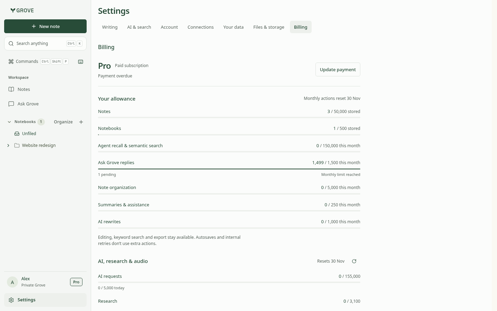 |  |  |  |

At 390×700, the billing alert spans y=−178…−142 while Refresh usage remains at
y=435.5…479.5 in the visible settings scroller. The 320px alert is also above the
viewport; desktop 1440×900 keeps it visible. The meter stays mounted. The top-alert
image deliberately scrolls up to show the actual feedback, not a second failure.
Archive selection leaves the sampled row geometry unchanged in all four contexts;
Clear selection focuses the header checkbox. No archive, restore, delete, rename,
checkout, portal, trial, payment, question send or provider request was executed.

| Long saved source                                                                                     | Unavailable saved source                                                                 |
| ----------------------------------------------------------------------------------------------------- | ---------------------------------------------------------------------------------------- |
|  |  |

Three focused source-reading contexts use 50 synthetic paragraphs at 1440×900,
390×700 and 320×480. Wheel plus Control+End leaves the final heading below the
viewport (about y=2,344 / 3,983 / 4,018); the parent hides overflow and no inner
reader scrolls. A discarded DOM-only body-scroller diagnostic makes the end
programmatically reachable, but does not establish touch/keyboard repair. At
320×480, only 121px remains for the article above the footer. The unavailable
source belongs to the initial four-context run; it is not a live access failure.

Completed runs record no page errors, horizontal overflow or blocked effect
attempts. Axe samples only the finder and normal Unicode-history dialogs at 390px
(no violations), not the entire state set. The static Billing taste inspector
separately resizes a JS-stripped rendered DOM at 1440×900 / 768×1024 / 390×844:
tiny-text is a heuristic failure, with palette/font/canvas/edge warnings. It includes
hidden DOM and cannot prove runtime font, interaction or nested-scroll acceptance.
All six inspector images were reviewed; its default picture/motion requirements
are not redesign requirements for an app screen. The selected five source files
have no taste-lint findings. No clean whole-app accessibility claim is made.

The fixture bypasses the real server-side Billing gate; an empty disabled component
is not evidence that the ordinary production route is blank. The fixture also owns
its document title: new tab-title/rename requirements use source inspection, not a
claim about production metadata observed here. Real Next history/cache/title,
screen-reader, iOS/Safari/device, provider and production acceptance remain separate.

## Public entry pages

Live `grovenote.app`, captured 26 November 2026. Home requested 1440×900 and its
scrollbar-adjusted capture is 1425×900; install is 1461×1008. Deployed source identity
was not established. These are public pages only; no sign-in or account changes.
The install screenshot records stale Chrome availability copy, not the owner’s
current store-approval state.

| Home                                      | Install                                                                         |
| ----------------------------------------- | ------------------------------------------------------------------------------- |
|  |  |
