# UI/UX review evidence

26 November 2026. [Findings and proposed direction](../../review/ui-ux.md).
These are **before** captures, not redesign previews.

## Web workspace

Development `622ca2b0b5b98801c21166be9d00965f72bfe42d`, product 1.11.37.
Actual components in the existing isolated dashboard fixture, built production
CSS, system UI text and synthetic notes/account/API responses. All viewports are
900px tall. No real account content, provider calls or production authentication.

| Notes, desktop                     | Notes, tablet                    | Notes, phone                     | Notes, narrow phone              |
| ---------------------------------- | -------------------------------- | -------------------------------- | -------------------------------- |
| 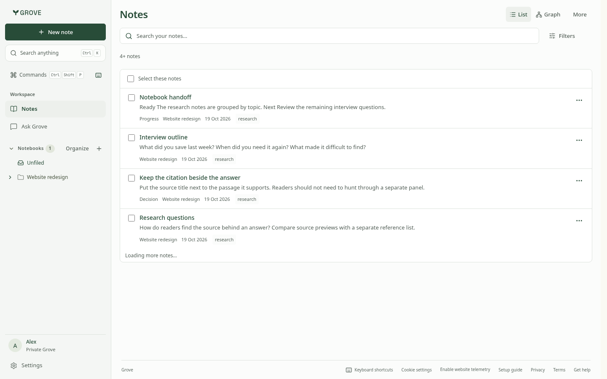 | 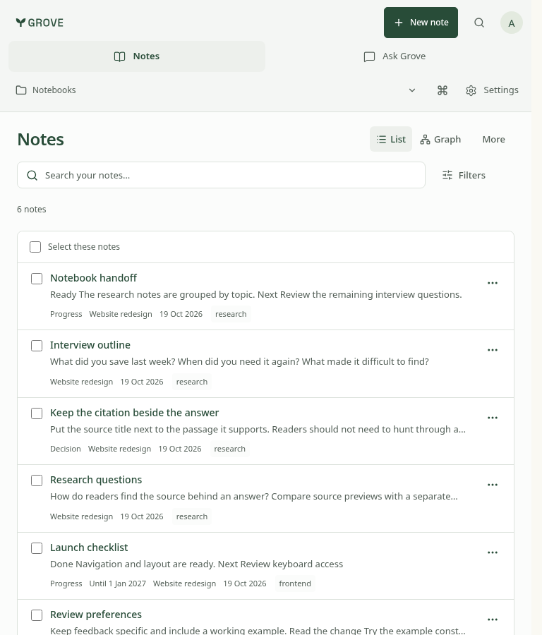 | 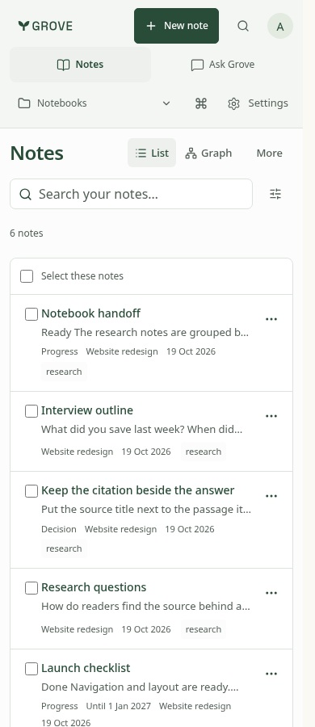 |  |

The 320px list uses progressive loading; “4+ notes” is the loaded count, not an
incorrect claim that the synthetic library contains only four notes.

| Editor, desktop                      | Editor, phone                      | Ask, desktop                         | Ask, phone                         |
| ------------------------------------ | ---------------------------------- | ------------------------------------ | ---------------------------------- |
| 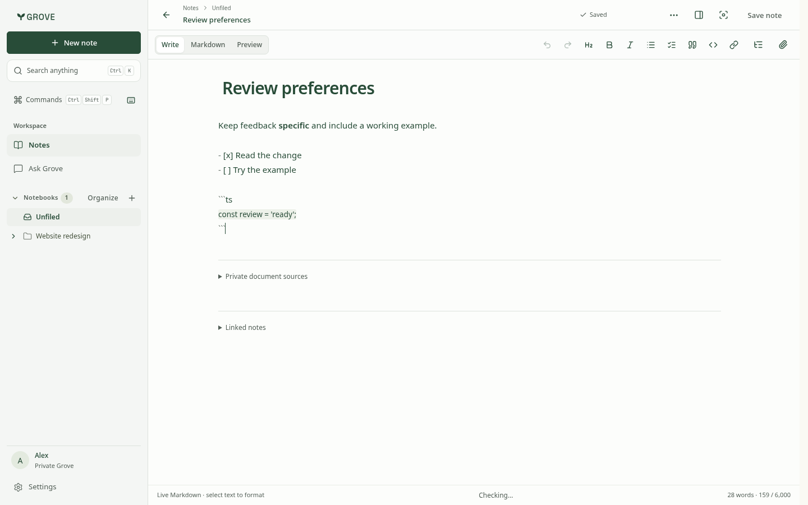 | 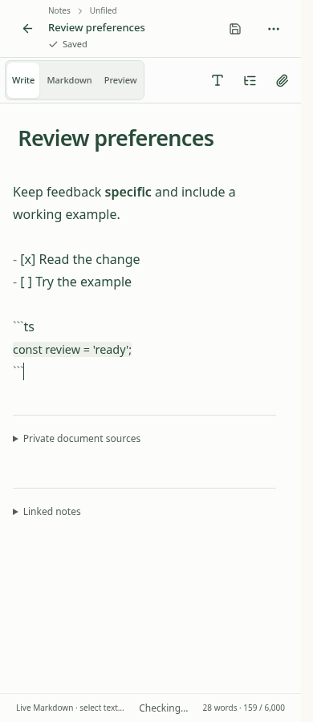 | 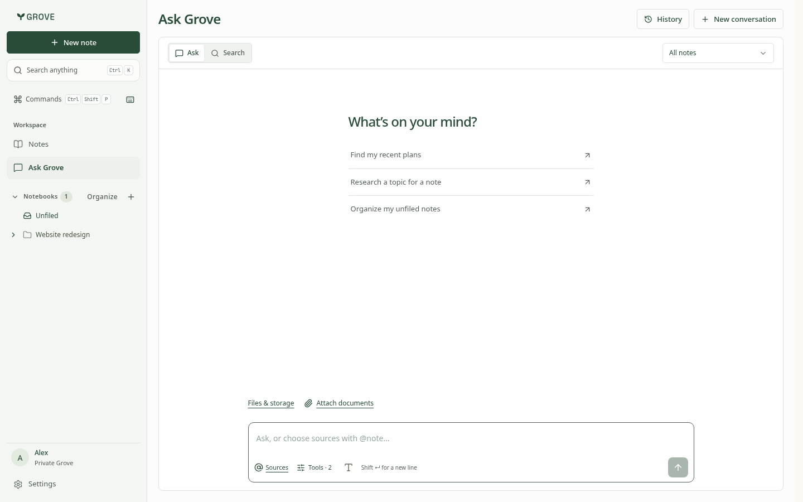 | 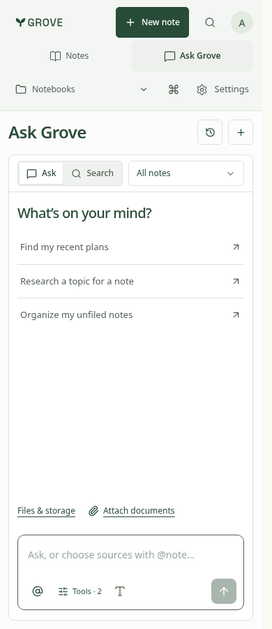 |

| Writing settings, desktop                        | Writing settings, phone                        |
| ------------------------------------------------ | ---------------------------------------------- |
|  | 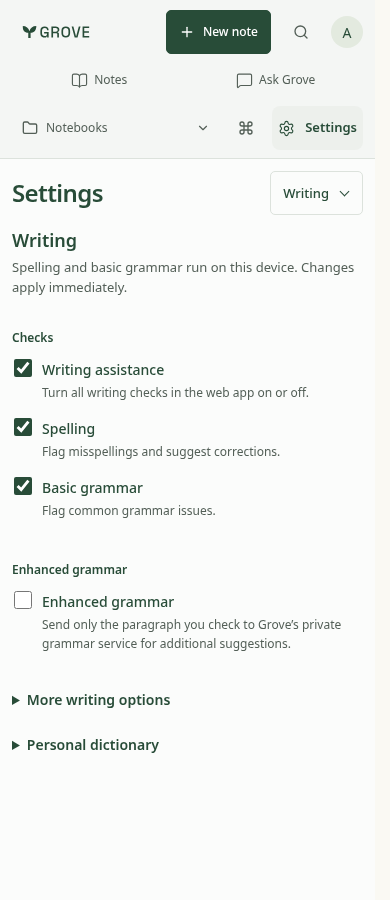 |

No horizontal page overflow or JavaScript page errors in these ten states.
Axe findings and their qualification are in the review; no full accessibility,
physical-device or production journey acceptance is claimed. The editor’s transient
Checking state is not proof of finished proofing or production service health.

## Extension

Same source, locally built Chrome package installed in isolated Chromium
156.0.8078.4 with mocked account/API/model responses. The synthetic example sentence
comes from the existing test fixture, not account data. Notes/Settings are 390×844;
writing alternatives are 320×480. A diagnostic capture changed only the test
navigation to expose Notes/Settings, not product code.

| Notes                                              | Settings                                                  | Writing alternatives                                                                       |
| -------------------------------------------------- | --------------------------------------------------------- | ------------------------------------------------------------------------------------------ |
| 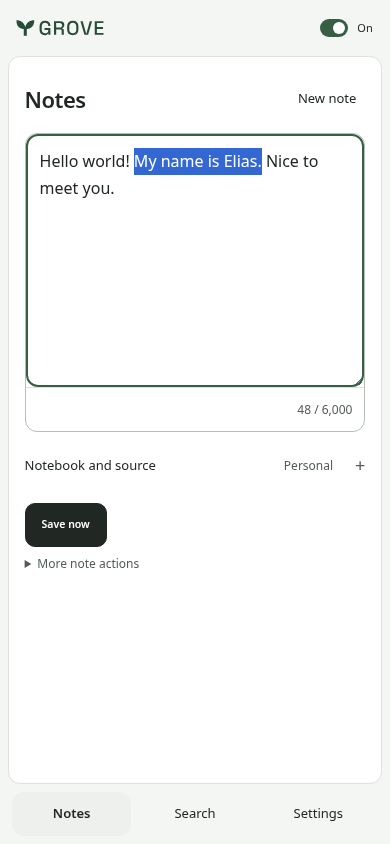 |  | 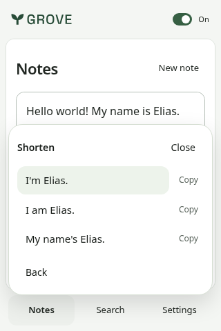 |

The host test initially failed a short-viewport geometry assertion; a fresh
unmodified Chrome run passed. The intermittent observation remains in the review.
This is not a full cross-browser installed-suite pass. No live AI, native
permission prompts or cross-store/browser-version parity is claimed.

## Public entry pages

Live `grovenote.app`, captured 26 November 2026. Home requested 1440×900 and its
scrollbar-adjusted capture is 1425×900; install is 1461×1008. Deployed source identity
was not established. These are public pages only; no sign-in or account changes.
The install screenshot records stale Chrome availability copy, not the owner’s
current store-approval state.

| Home                                      | Install                                                                         |
| ----------------------------------------- | ------------------------------------------------------------------------------- |
| 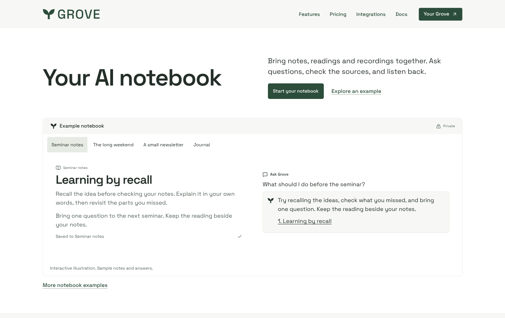 | 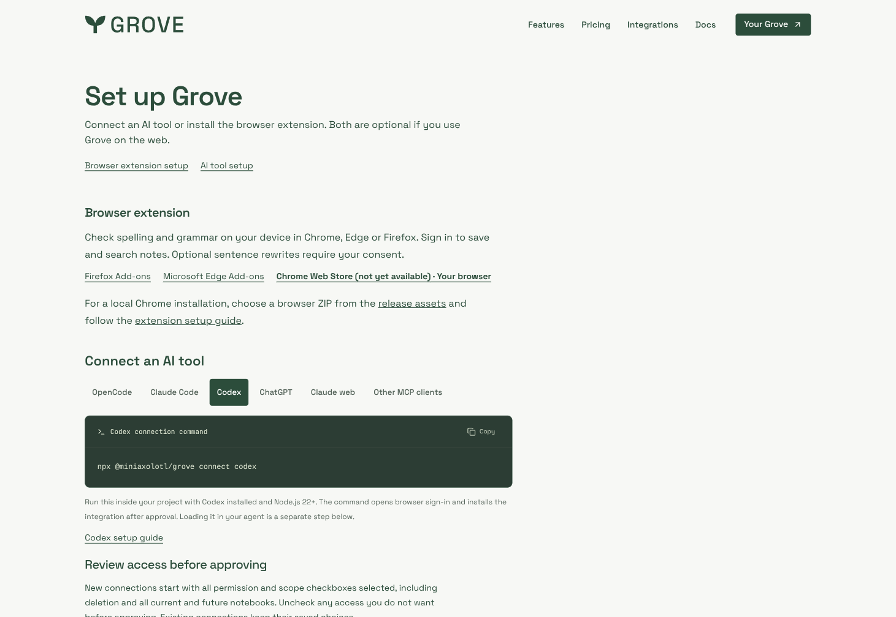 |
