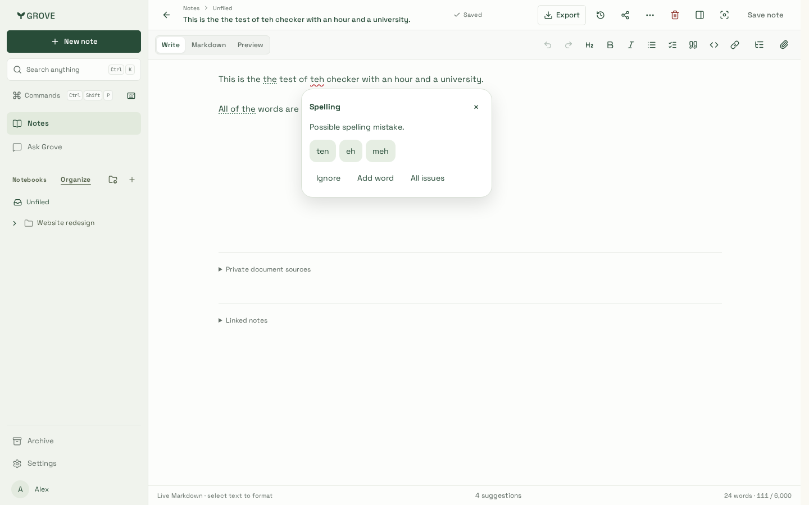
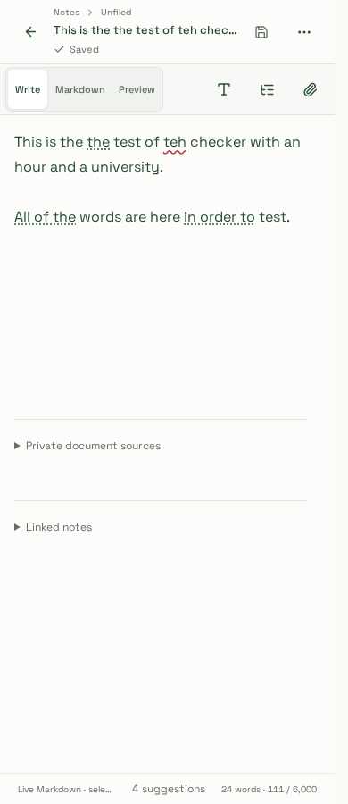
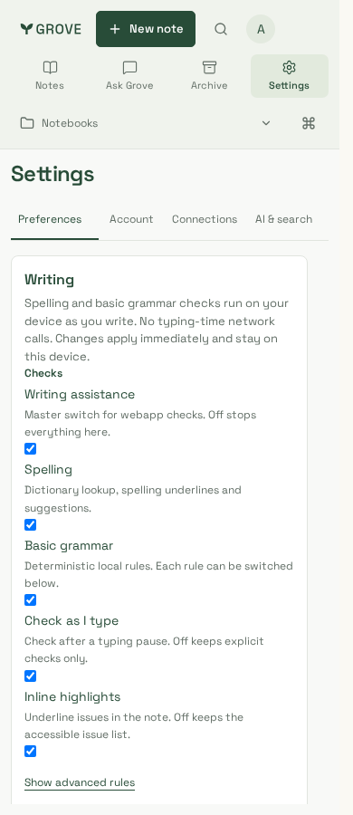
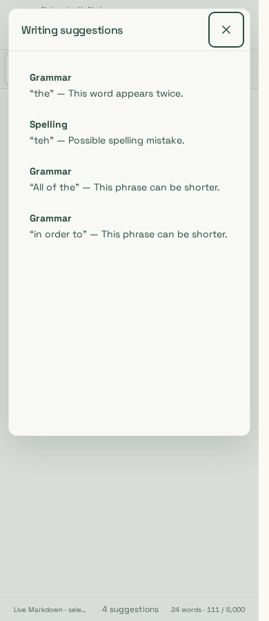

# Webapp writing checks

Reviewed captures from `packages/website/tests/writing.spec.ts` (Playwright,
fixture-backed, real engine + pinned `dictionary-en` 4.0.0 served from
`/dictionaries`). Draft: “This is the the test of teh checker …” — the
repeated “the”, “teh”, “All of the” and “in order to” are flagged; “an hour”
and “a university” correctly abstain.

|  |  |  |  |
| --- | --- | --- | --- |

- `writing-card-1440.png` — anchored Spelling card: explanation, three
  lookup-only replacements, Ignore / Add word / All issues. One click applies
  with native Undo; stale sources ask for a recheck instead of editing.
- `writing-underlines-390.png` — red wavy spelling vs dotted green grammar
  underlines; quiet footer count (“4 suggestions”), no success panel.
- `writing-settings-390.png` — Settings → Preferences → Writing: master,
  spelling, grammar, as-you-type and highlight switches; rules and dictionary
  behind disclosures. Device-local; extension dictionary stays separate.
- `writing-list-390.png` — Alt+Enter issue list with human explanations,
  keyboard accessible, Escape returns to the editor.

Flow coverage (asserted, not just pictured): underline click → card → apply →
Ctrl/Cmd+Z restores the original; All-issues navigation; disabling Spelling
removes only spelling underlines while grammar remains; the
`data-grove-native-writing` marker is present so the installed extension
stands down on Grove pages.
