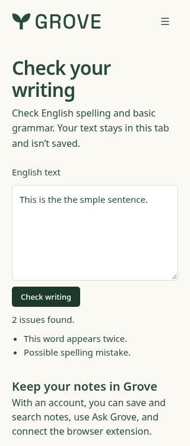
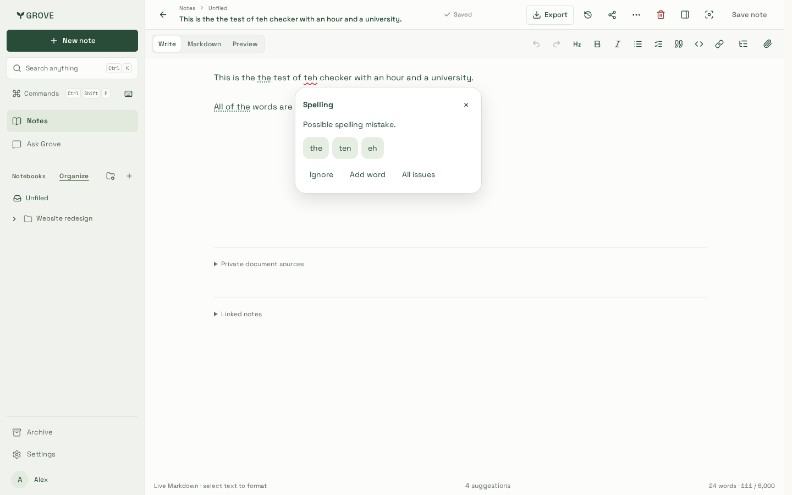
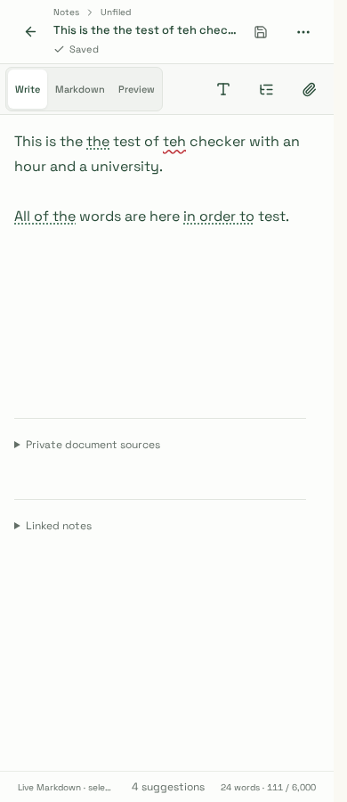
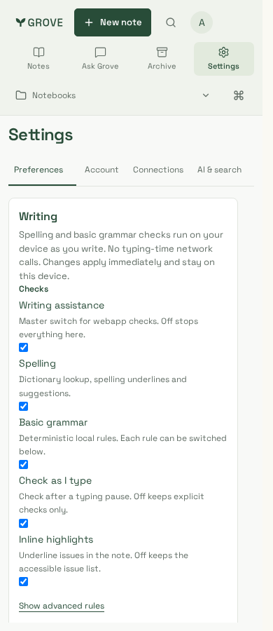
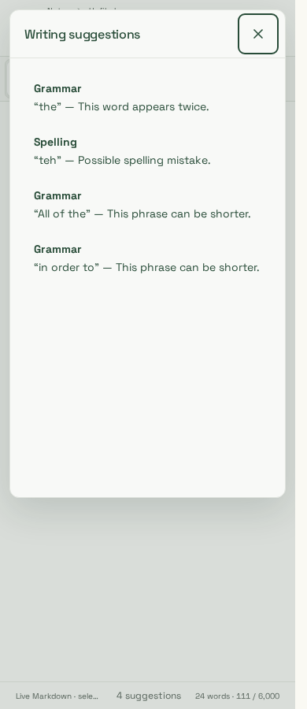
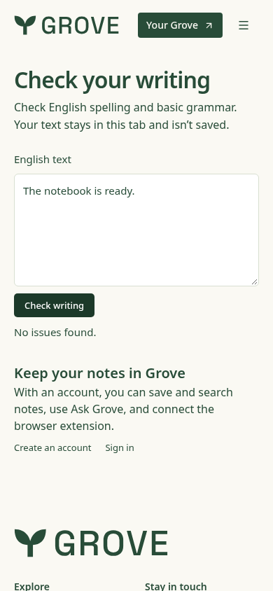

# Webapp writing checks

## Guest suggestions

Local Next.js production build of `fix/guest-writing-excerpts`, Playwright Chromium.
`guest-writing-excerpts.spec.ts` submits “Please bring the the notebok.” using
the keyboard and checks each word with its explanation. Captures: 320 × 750
(above), [390 × 844](guest-writing-messages-390.png), and
[1440 × 900](guest-writing-messages-1440.png). The test also exercises missing
and extra spaces, literal angle brackets, and a long word. These checks use
the bundled English dictionary, not a live site or a physical device.

## Note editor

Reviewed captures from `packages/website/tests/writing.spec.ts` (Playwright,
fixture-backed, real engine + pinned `dictionary-en` 4.0.0 served from
`/dictionaries`). Draft: “This is the the test of teh checker …” — the
repeated “the”, “teh”, “All of the” and “in order to” are flagged; “an hour”
and “a university” correctly abstain.

|  |  |  |  |
| -------------------------------------------------------------------------------------------- | -------------------------------------------------------------------- | -------------------------------------------------------- | ------------------------------------------------- |

- `writing-card-1440.png` — anchored Spelling card: the obvious fix first
  (**the**, not ten/eh), explanation, Ignore / Add word / All issues. One
  click applies with native Undo; Escape or × returns focus to the editor;
  card flips above the issue near the viewport bottom. Stale sources ask for
  a recheck instead of editing.
- `writing-underlines-390.png` — red wavy spelling vs dotted green grammar
  underlines; quiet footer count (“4 suggestions”), no success panel.
- `writing-settings-390.png` — Settings → Preferences → Writing: master,
  spelling, grammar, as-you-type and highlight switches; rules and dictionary
  behind disclosures. Device-local; extension dictionary stays separate.
- `writing-list-390.png` — Alt+Enter issue list with human explanations,
  keyboard accessible, Escape returns to the editor.

Flow coverage (asserted, not just pictured): underline click → card → apply →
Ctrl/Cmd+Z restores the original; All-issues navigation; disabling Spelling
removes only spelling underlines while grammar remains; the
`data-grove-native-writing` marker is present so the installed extension
stands down on Grove pages.

## Typing while the guest checker loads

Local Next.js production build of `fix/guest-writing-hydration`, Playwright Chromium,
390 × 844. `guest-writing-hydration.spec.ts` holds the page scripts, enters
“The notebook is ready.”, releases the scripts and checks the draft without a
second edit. The screenshot shows the resulting status. This verifies simulated
slow loading on a local build, not physical-device or live-site performance.
