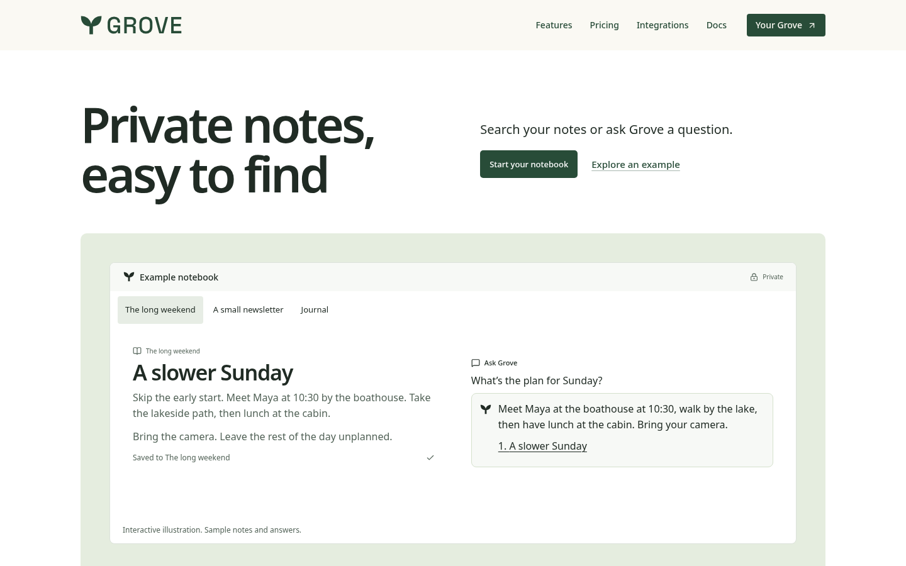
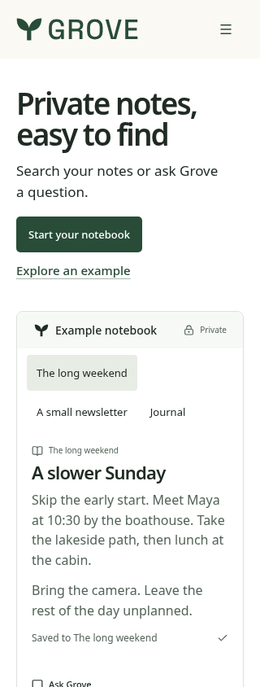
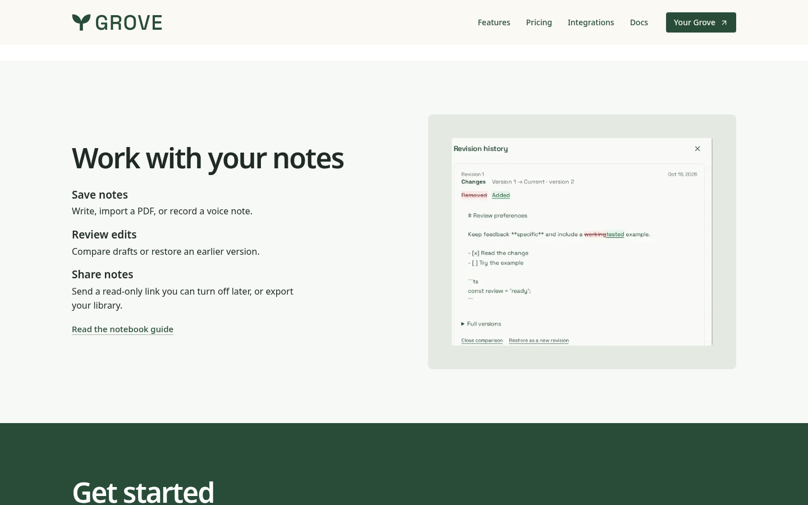
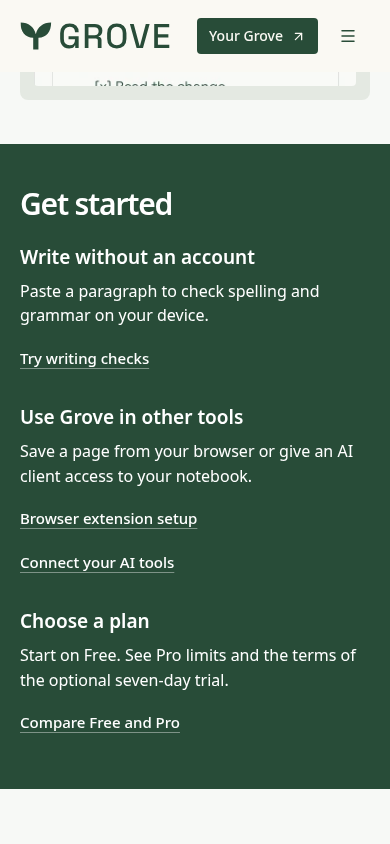

# Notebook overview

Local optimized build `ko_KRX50h4a35D_EARo3e` on `feat/website-product-overview`, based on `9ee71cc9`. Captured in Chromium with the built-in sample notes and optional cookies declined.

| Desktop opening | Narrow opening | Features | Setup choices |
| --- | --- | --- | --- |
|  |  |  |  |

Reviewed the opening, Features and setup at 320×844, 390×844 and 1440×900 with both light and dark system preferences. Public pages use the same Grove palette for both. The desktop notebook pairs the note with its cited answer; phones stack them. No horizontal overflow or page errors appeared in these six local states.

The shorter opening fits two lines at 320px and one at 390px above the signup action. In the [390px Features view](features-390-dark.png), the three actions and the changed words in the revision comparison fit on one screen.

The revision illustration uses desktop and phone crops of the real [revision comparison fixture](../../structured-documents/README.md); the interactive notebook uses illustrative notes and answers. Neither contains account data. These captures cover the public page, not a live Ask provider or trial checkout.
