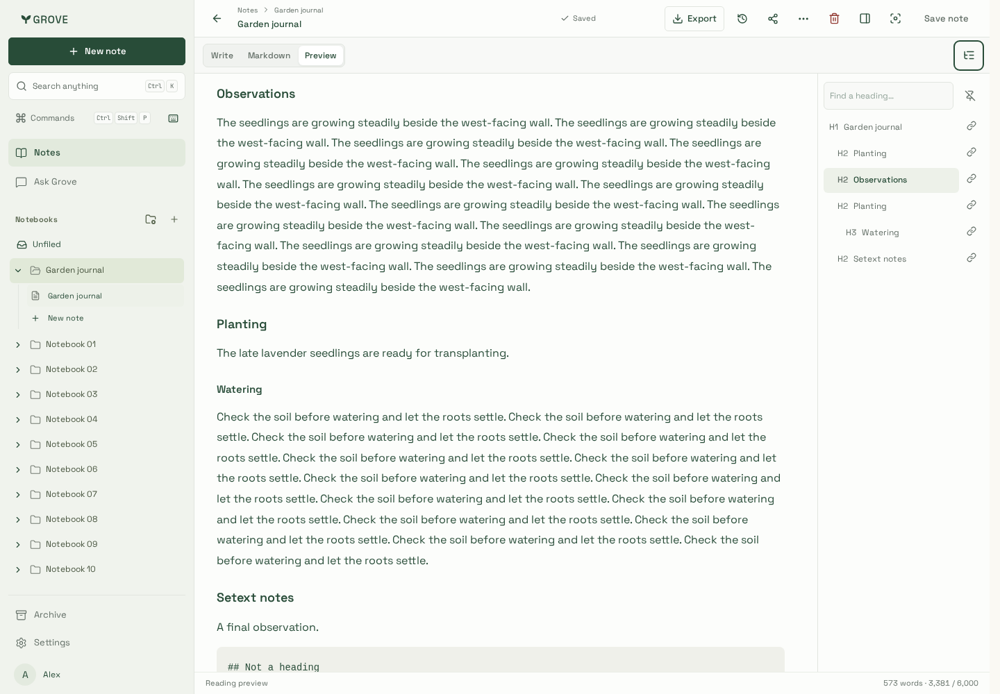
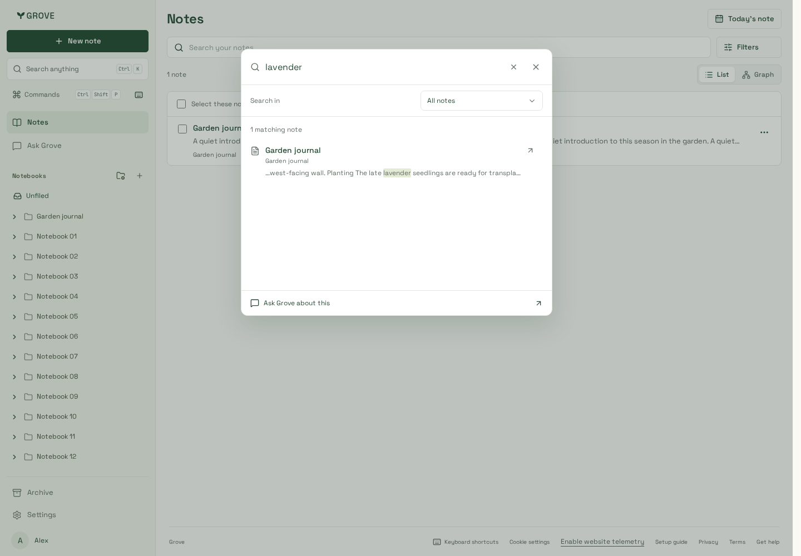
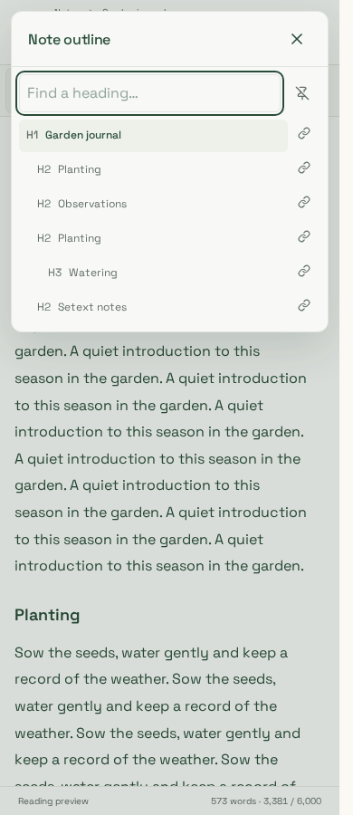
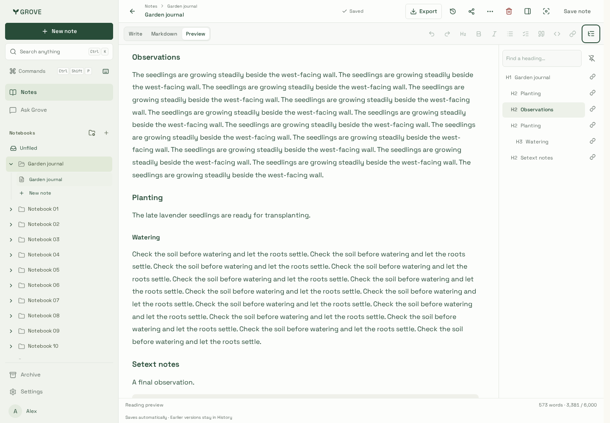
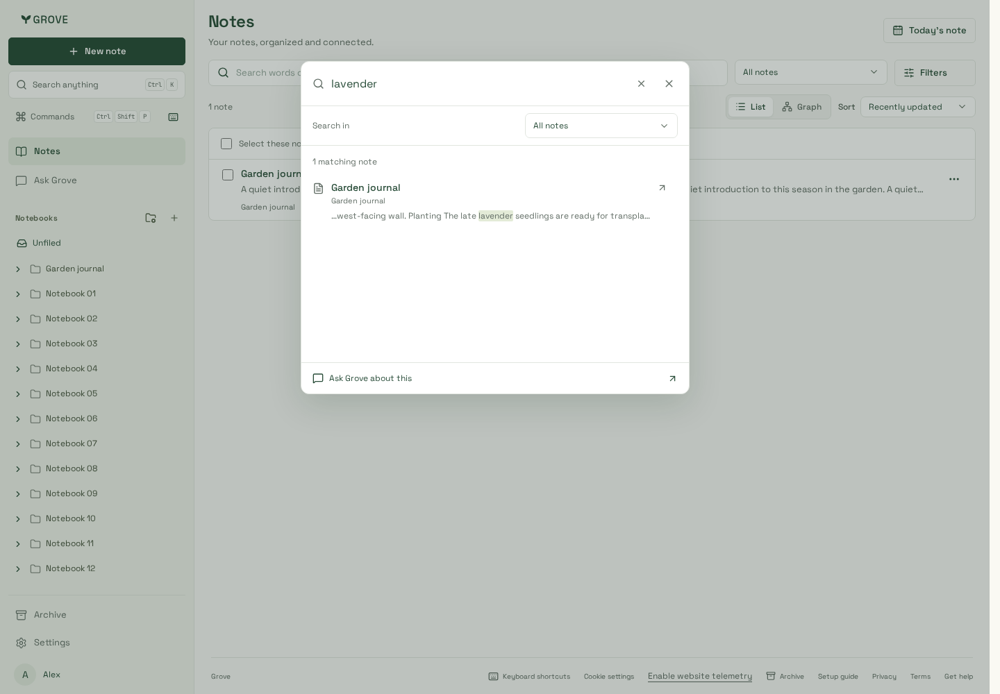
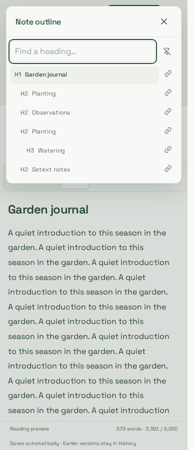

# Workspace navigation

## Latest workspace-polish integration

Navigation head `8baf410` integrated with landed workspace polish #96 (`26e28e1`),
production build `5WJSQw8VedeBwwSPFpXj4`, 23 October 2026. Documentation conflicts
preserve both delivery histories and the new Filters panel. Both-engine navigation
journeys pass on the combined tree; the original captures below remain historical.
Notes entry is **487,661 gzip bytes**, with the editor still deferred. Current-head
full integration checks are linked from [PR #97](https://github.com/miniaxolotl/grove/pull/97).
The **12 focused WebKit** scenarios pass after four existing checks were reconciled
with #96's intentional compact-note changes: New note uses its shared shortcut,
Delete uses the existing action helper, and leaving focus mode keeps the compact
sidebar hidden with Back to notes available. Save, Undo and focus checks remain.
All **11 library/filter WebKit** checks also pass on the combined tree.

| Integrated pinned outline                                              | Integrated search                                             | Integrated phone outline                                             |
| ---------------------------------------------------------------------- | ------------------------------------------------------------- | -------------------------------------------------------------------- |
|  |  |  |

## Original navigation captures

Application source: `c544123`. Production build `Rm33UWwzrqV1JnCluojuo` on Node
24.22.1 / pnpm 10.33.0, with synthetic telemetry identifiers and fixture-only notes.
Captured 23 October 2026 with Playwright 1.64.1. WebKit runs in
`mcr.microsoft.com/playwright:v1.64.1-noble`; Chromium runs locally. These show real
workspace components and production CSS, not production account data.

The subsequent integration of development `eaa717a` preserves these navigation
sources and captures. Its inherited dropdown-opacity correction affects none of
the pictured states; integrated bundle size is unchanged. See
[PR #97](https://github.com/miniaxolotl/grove/pull/97) for current-head integration CI.

| Pinned outline                      | Search passage                     | Phone outline                     |
| ----------------------------------- | ---------------------------------- | --------------------------------- |
|  |  |  |

## Capture inventory

Each capture also has a [WebKit counterpart](webkit/).

- [Desktop outline](outline-1440.png): compact optional rail, hierarchy, current
  section and independent copy controls. Its search field retains useful width.
- [Global search](search-1440.png) and [Ask/Search](ask-search-1440.png): matching
  word in a late passage, notebook path and quiet highlights.
- [Clipboard fallback](copy-fallback-1440.png): selectable private URL inside the
  active inspector; the pinned document keeps its width behind the modal.
- [Tablet](outline-768.png), [phone](outline-390.png) and [320px](outline-320.png):
  the same searchable rows in the inspector, no cramped permanent rail.
- [Short forced-colour view](outline-forced-320.png): 320 × 500, reduced motion,
  visible focus and reachable final section. WebKit's image records that engine's
  supported colour emulation; it is not physical-device forced-colour qualification.

## Verification

- Root and website lint/type/build gates, five packed-artifact checks and bundle
  budgets pass. Notes entry: **487,751 gzip bytes**; editor remains deferred.
- All **223 Chromium** scenarios pass. **Twelve focused WebKit** scenarios pass for
  stable tools, sidebar/enlarged text, normalized outline, first/held saves, commands,
  nested keyboard scope, history focus and search recovery. **15 repeated Chromium
  history checks** pass. The focused set is committed as
  `playwright.navigation-webkit.config.ts`; existing frontend test files are unchanged.
- Navigation-specific fixture journeys pass in **both engines**: duplicate fragment
  load, reload, same-note hash changes and Back/Forward; commands/shortcut/search/Enter;
  pinning/current-section scroll; writing navigation without save plus normal edit/Undo;
  synthetic clipboard success and simulated denial/manual fallback;
  late-match passages in global search, Ask/Search and filtered rows; desktop/mobile
  scroll reload with delayed directories; account/session replacement; removed notebook
  pruning; malformed/blocked storage; unsaved-note copy disabled. Narrow inspector
  layouts pass automated WCAG A/AA checks and document-overflow assertions.
- Direct helper checks cover Unicode/formatted/quoted/Setext headings, CRLF offsets,
  duplicate slug collisions, fenced examples, literal highlighting and bounded repeated
  tokens (100,000 characters, 15ms observed locally; not a production latency claim).

Initial browser verification exceeded the tool's two-minute timeout. A separate
attempt was invalidated by rebuilding while fixture servers referenced old CSS;
the server's headers-sent error caused connection refusals, not application failures.
The next complete run exposed a copy-button/heading accessible-name collision; copy
actions now have a concise name with their heading as an accessible description.
Repeated full verification also exposed an existing history-open focus race: the
conversation could take focus before its modal closed, then lose it to the modal's
focus-restoration cleanup. Waiting for React's closed state alone was insufficient:
instrumented focus calls showed the log gaining focus and cleanup taking it back
four milliseconds later. An explicit `onDismissed` callback now runs after cleanup
for history review/deletion and heading jumps, retaining the
existing focus assertions. Clipboard denial also replaces any earlier copy-success
toast with manual-copy instructions.

Chrome DevTools could not attach to the workstation browser, so visual review uses
these isolated browser captures. Physical software keyboards, OS clipboard policies,
touch/trackpad feel and production rollout are not qualified here. See the
[verification matrix](../../../development/testing.md) and
[interaction contracts](../../../development/stable-interactions.md).
