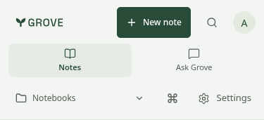
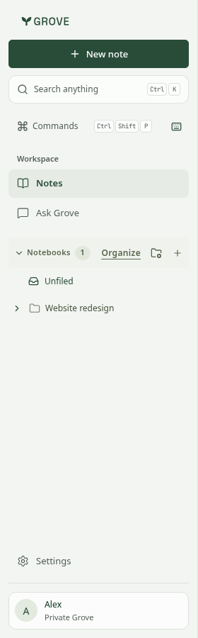

# Workspace navigation

Sidebar crops from the `Settings follows notebooks` Chromium test using the
optimized website build and a synthetic account. The test covers 320, 390, 768,
and 1440 px, including keyboard activation and overflow checks.

| 390 px                                                                                                        | 1440 px                                                                                             |
| ------------------------------------------------------------------------------------------------------------- | --------------------------------------------------------------------------------------------------- |
|  |  |

These captures verify responsive layout in Chromium, not physical-device or
production sign-in behavior.
