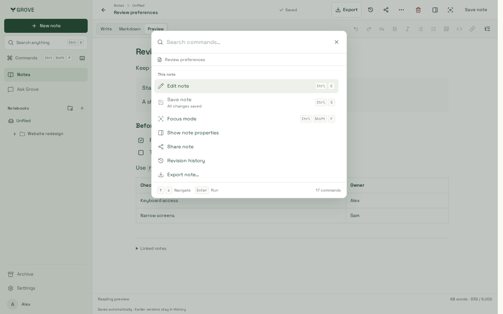
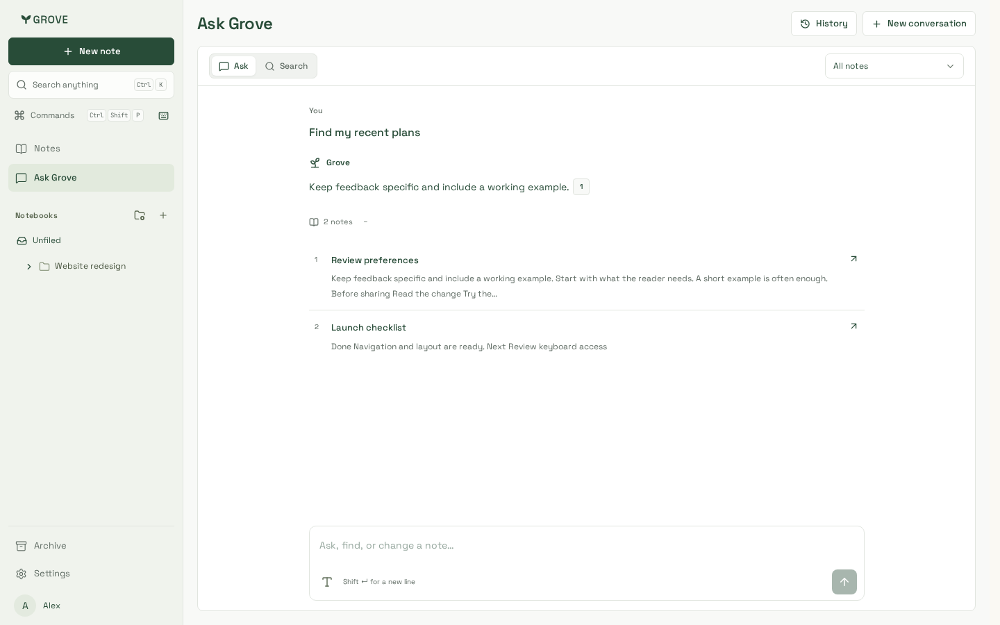

# Workspace polish follow-up

Reviewed 22 October 2026 with synthetic notes, actual workspace components and
production-built CSS. Eighteen captures show the follow-up to [command palette
and note tools](../command-palette/).

## Captures

- `commands-1440.png`, `commands-320.png`: full-row selection, restrained overlay
  shading and shared workspace colours. `commands-contrast-390.png` shows the
  complete selection outline in forced-colour mode.
- `notes-1440.png`: clean shared excerpts and quiet idle drag grips.
- `actions-1440.png`, `actions-390.png`, `select-320.png`, `export-390.png`:
  readable menus, inset keyboard focus, stationary dropdowns and compact headings.
- `reader-1440.png`, `reader-768.png`, `reader-320.png`, `writing-320.png`:
  quotes use inset spacing and neutral surfaces rather than coloured edge rails.
- `ask-welcome-1440.png`, `ask-welcome-768.png`, `ask-welcome-390.png`:
  concise suggestions and a composer sized to the space below navigation.
- `ask-sources-1440.png`, `ask-sources-320.png`: divided source rows with plain-text
  excerpts; the conversation scrolls independently of the composer.
- `ask-short-320.png`: a 520px-high window can scroll the page to reach the
  composer while retaining internal conversation scrolling and Latest reply.

## Verification

Application source `f33fd3a005d821ab7f60540878243ae50dab787f`, production build
`4y6BIc8sNSUwPBNlezNtF`, Node 24.21.0, pnpm 10.33.0 and Playwright 1.64.1.
These captures use Chromium at 1440/768/390/320px; phone layouts include touch
emulation. The separate iPhone/WebKit checks use the pinned Noble container.

The full **193-case Chromium** suite passes for the visual treatments, followed
by **20 affected excerpt** and **seven conversation/control** checks. The final
submission-harness check passes on both Chromium and WebKit. **Eighteen focused
WebKit** cases pass, with five affected cases verified after the final changes.
The newly included WebKit conversation test uses modified Enter because ordinary
Enter deliberately inserts a newline on touch layouts.

Root/website lint, types and builds, all five artifact checks and bundle budgets
pass. Notes entry is **481,587 gzip bytes**, with the editor deferred. Visual review
also checks forced colours, keyboard source-dialog focus return, Axe, viewport
bounds and short-window reachability. Broader existing coverage includes enlarged
text, pinch zoom, stable note controls, task editing, autosave and conflict recovery.
