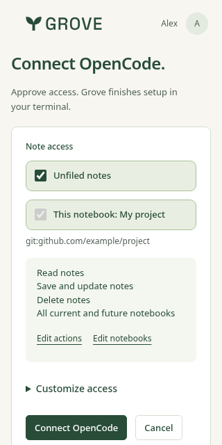

# Workspace refinement

## Contextual approval summary — 27 November 2026

Actual approval form with synthetic HTTP/account data, Chromium at 320×640,
production CSS build `SWTOYpeDBLJvByhY0ZFwJ`, parent `4e2ac9f` plus the contextual
approval changes. The summary's **Edit actions** and **Edit notebooks** open/focus
the existing controls; they never submit approval. The complete-catalog regression
retains narrowed choices through a notebook-read failure/retry and verifies no
approval request until confirmation. The compact initial form keeps Connect and
Cancel fully visible at this size without hiding access consequences.
The contextual summary actions retain the shared 44px targets.

This is browser-fixture evidence, not an account grant, live Clerk install timing,
screen-reader or physical-device acceptance. Earlier captures below are unchanged.

## Earlier workspace review

Reviewed browser-fixture captures using production CSS and synthetic notes. Source:
`e31e438` on `fix/workspace-refinement`, 22 October 2026. Production CSS build
`bb1JRm4mEIK8YwzqY7LrK`; Node 24.21.0 / pnpm 10.33.0 / Playwright 1.64.1.

## Navigation and controls

- [Desktop sidebar](sidebar-expanded-1440.png)
- [Phone sidebar](sidebar-expanded-390.png)
- [Narrow sidebar](sidebar-expanded-320.png)
- [Note drag preview and destination](sidebar-note-drag.png)
- [Desktop note controls](note-read-1440.png)
- [Phone note controls](note-read-390.png)
- [Narrow writing controls](note-write-320.png)

Folder/file icons serve as drag handles. Notebook titles have more room, Commands
and keyboard help share a baseline, and compact desktop controls retain separate
44px touch targets. Flat green/outlined buttons follow the public site's styling.

## Outline and focus

- [Content-sized outline](note-outline-1440.png)
- [Narrow outline](note-outline-320.png)
- [Focus mode with reachable modes and current section](focus-outline.png)

## Ask/Search

- [Desktop pending search](search-pending-1440.png)
- [Desktop results](search-results-1440.png)
- [Phone results](search-results-390.png)
- [Narrow results](search-results-320.png)

Mode and notebook controls align; the search field/status retain their positions
through loading, results, clearing and retry. The full browser suite also checks
short windows, enlarged text, reduced motion, keyboard/touch and accessibility.

## Automatic note continuation

18 November 2026 UTC · `feat/workspace-infinite-scroll` on base `c8de2701` ·
production CSS build `UQ53TPHD8KH8DIXA8T2YF`. Playwright Chromium 1.64.1 rendered
actual workspace components with synthetic notes and mocked cursor responses.

- [Notes after scrolling (1440 × 760)](scroll-append-1440.png): focus moves with
  Arrow Down from the last original row to the first appended row while selection stays active.
- [Notebook sidebar (390 × 640)](scroll-sidebar-390.png): notes 14–19 are
  reachable in the sidebar’s own scroll area; **New note** is still at the end.
- [Keyboard continuation (1280 × 720)](scroll-keyboard-1280.png): with the
  observer disabled in the fixture, Tab reveals the fallback at the list edge.

These are browser-fixture captures, not a live account, physical-device test,
or validation with a native screen reader. The fallback's browser accessibility
tree and keyboard focus state are covered by automated tests.
