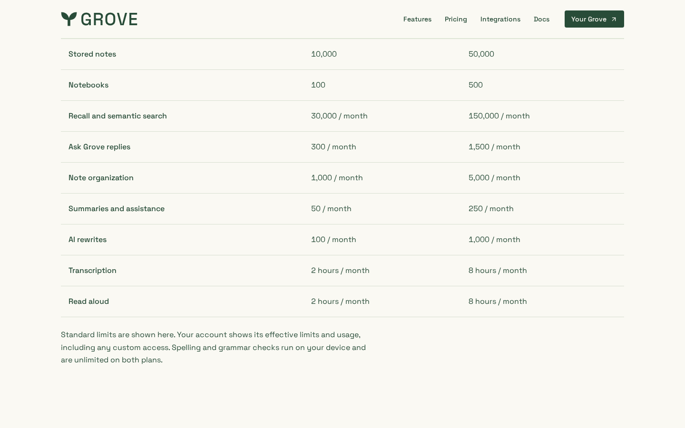
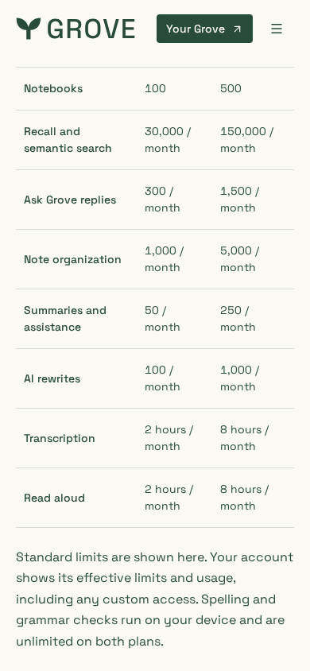
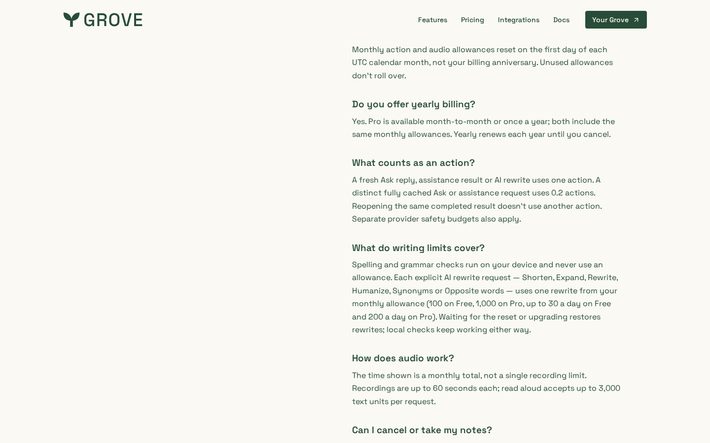

# Writing limits on /pricing

The allowance table gains an **AI rewrites** row (100 / month Free,
1,000 / month Pro) fed by the shared `resourceLimits`, a note that on-device
spelling and grammar checks are unlimited on both plans, and a "What do writing
limits cover?" FAQ (daily burst 30 Free / 200 Pro, cached reopen free). "What
counts as an action?" now names rewrites. No layout change beyond the added
row; the table scrolls horizontally on narrow phones.

Local production build, first-visit cookies declined, locale en-US.

| Allowance table, desktop | Allowance table, 390px | Writing FAQ, desktop |
| --- | --- | --- |
|  |  |  |
